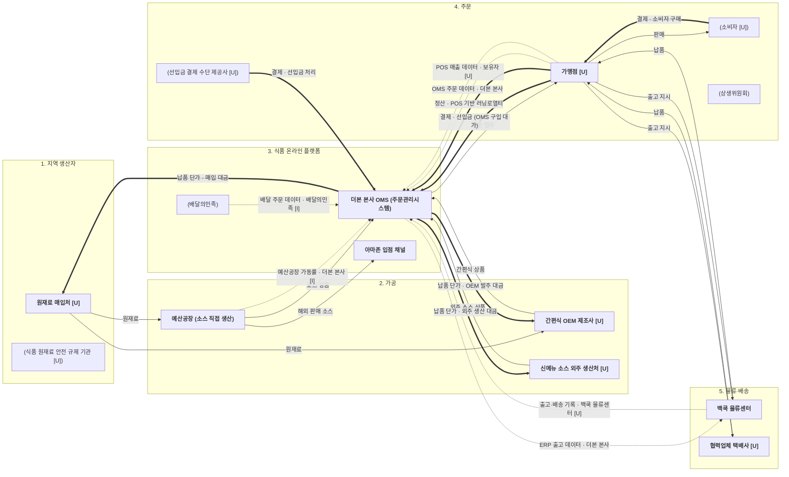

# 더본코리아 산업 밸류체인 v0

- 기업: 더본코리아 · 트랙: 푸드
- 입력: onepager.md (C:\Users\Green\Downloads\onepager.md, 작성일 2026-11-06)
- 단계: 팀이 정한 5단계 (지역 생산자 → 가공 → 식품 온라인 플랫폼 → 주문 → 물류·배송)
- 표기: **굵게** = 하는 사람 · (괄호) = 영향 주는 사람 · `[U]` = 미확인 · `[I]` = 해석
- 숫자는 onepager에 [출처]가 있는 것만 씀. 다이어그램 안에는 숫자를 넣지 않음.

## 밸류체인 (Mermaid)

## 단계별 근거

| 단계 | 노드 | 원페이지 칸 | 출처 |
| --- | --- | --- | --- |
| 1. 지역 생산자 | 원재료 매입처 [U] | 2번 칸 '얼마나 들어': 원재료 매입 합계 39,202 백만원 | [출처 1] |
| 1. 지역 생산자 | 식품 원재료 안전 규제 기관 [U] | 원페이지에 언급 없음 | [U] |
| 2. 가공 | 예산공장 (소스 직접 생산) | 2번 칸 '무엇을': 소스류(액상·분말) 직접 생산 | [출처 1] |
| 2. 가공 | 간편식 OEM 제조사 [U] | 2번 칸 '얼마나 들어': 간편식(OEM) 20,339 백만원 | [출처 1] |
| 2. 가공 | 신메뉴 소스 외주 생산처 [U] | 8번 칸 충돌: '신메뉴 조리용 소스는 생산은 외주' (verify K5) | [출처 3] |
| 3. 식품 온라인 플랫폼 | 더본 본사 OMS | 2번 칸 '어떻게 전달': OMS(주문관리시스템), ERP | [출처 1] |
| 3. 식품 온라인 플랫폼 | 아마존 입점 채널 | 6번 칸 플랫폼 입점·D2C: 아마존 입성 완료 | [출처 3] |
| 3. 식품 온라인 플랫폼 | 배달의민족 | 4번 칸 최근 동향: '배달의민족' 주문 시 4,000원 할인 | [출처 5] |
| 4. 주문 | 가맹점 [U] | 2번 칸 '어떻게 전달': 선입금 한도 안에서 OMS로 원·부자재 주문 | [출처 1] |
| 4. 주문 | 소비자 [U] | 2번 칸 ⑥ 소비자 프로모션 (매출차감 (33,238) 백만원) | [출처 1] |
| 4. 주문 | 상생위원회 | 5번 칸 이슈 ①: 본사임원·가맹점대표·외부전문가 3자 협의체 | [출처 3] |
| 4. 주문 | 선입금 결제 수단 제공사 [U] | 2번 칸 '어떻게 전달': 주문 선입금 제도 (제공사는 미확인) | [출처 1] |
| 5. 물류·배송 | 백쿡 물류센터 | 2번 칸 '어떻게 전달': 직접출고 (위치·규모는 8번 칸 [U]) | [출처 1] |
| 5. 물류·배송 | 협력업체 택배사 [U] | 2번 칸 '어떻게 전달': 택배 외주출고 | [출처 1] |
| 돈 흐름 (전체) | 결제·정산·납품 단가 | 2번 칸 '어떻게 돈': OMS 물품 구입 대가 + POS매출 기준 러닝로열티. 로열티 금액·납품 단가는 [U] (8번 칸) | [출처 1] |
| 데이터 흐름 (전체) | OMS·ERP·POS 데이터 보유자 | 2번 칸: OMS·POS·ERP 원 데이터는 본사 내부 데이터로 외부 수령 가능 여부 미확인 [U]. 백쿡 물류센터 데이터 보유 여부도 [U] (8번 칸) | [출처 1] · [U] |

## 확인 필요

- 원재료 매입처, OEM 제조사, 외주 생산처, 협력업체 택배사, 가맹점, 소비자, 선입금 제공사는 원페이지에 이름이 없어 `[U]`입니다.
- 돈 흐름 라벨 중 '납품 단가'와 '정산'의 금액 구조는 원페이지에 없습니다. 라벨 이름만 적었습니다.
- 데이터 흐름 중 배달의민족 데이터와 예산공장 가동률 데이터의 보유자는 `[I]`입니다.
- 소스 생산 방식은 자체 생산(출처 1)과 외주 생산(출처 3)이 충돌합니다. 두 노드를 모두 남겼습니다.
