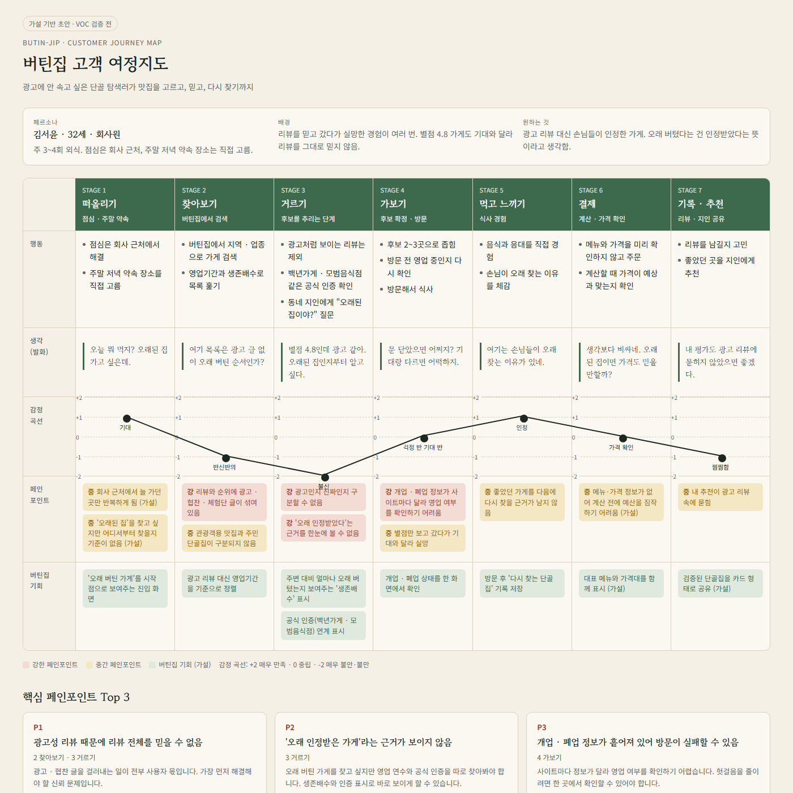

# 버틴집 고객 여정지도

> **가설 기반 초안 · VOC 검증 전**
> 페르소나 김서윤의 맛집 탐색부터 추천까지, 7단계 여정.

## 페르소나

**김서윤 · 32세 · 회사원** (가상 인물)

- **외식 빈도**: 주 3~4회. 점심은 회사 근처, 주말 저녁 약속 장소는 직접 고름
- **배경**: 리뷰를 믿고 갔다가 실망한 경험이 여러 번. 별점 4.8 가게도 기대와 달라 리뷰를 그대로 믿지 않음
- **원하는 것**: 광고 리뷰 대신 손님들이 인정한 가게. 오래 버텼다는 건 인정받았다는 뜻이라고 생각함

## 여정 한눈에 보기

| 구분 | 1. 떠올리기 | 2. 찾아보기 | 3. 거르기 | 4. 가보기 | 5. 먹고 느끼기 | 6. 결제 | 7. 기록·추천 |
|---|---|---|---|---|---|---|---|
| **상황** | 점심·주말 약속 | 버틴집에서 검색 | 후보 추리기 | 후보 확정·방문 | 식사 경험 | 계산·가격 확인 | 리뷰·지인 공유 |
| **감정 (-2~+2)** | +1 기대 | -1 반신반의 | **-2 불신** | 0 걱정 반 기대 반 | +1 인정 | 0 가격 확인 | -1 찜찜함 |
| **강한 페인포인트** | - | 광고·협찬 글이 섞인 리뷰와 순위 | 광고인지 진짜인지 구분 불가, 오래 인정받았다는 근거 부재 | 개·폐업 정보가 사이트마다 달라 영업 여부 확인 어려움 | - | - | - |
| **버틴집 기회 (가설)** | '오래 버틴 가게'를 시작점으로 | 영업기간 기준 정렬 | 생존배수·영업 연수, 공식 인증 연계 표시 | 개·폐업 상태 한 화면 확인 | 다시 찾는 단골집 기록 | 대표 메뉴와 가격대 함께 표시 | 검증된 단골집 카드 공유 |

## 단계별 상세

### 1. 떠올리기 (점심 · 주말 약속)

- **행동**: 점심은 회사 근처에서 해결. 주말 저녁 약속 장소를 직접 고름
- **생각(발화)**: "오늘 뭐 먹지? 오래된 집 가고 싶은데."
- **감정**: +1 (기대)
- **페인포인트**
  - 🟡 **중**: 회사 근처에서 늘 가던 곳만 반복하게 됨 (가설)
  - 🟡 **중**: '오래된 집'을 찾고 싶지만 어디서부터 찾을지 기준이 없음 (가설)
- **버틴집 기회**: '오래 버틴 가게'를 시작점으로 보여주는 진입 화면

### 2. 찾아보기 (버틴집에서 검색)

- **행동**: 버틴집에서 지역·업종으로 가게 검색. 영업기간과 생존배수로 목록 훑기
- **생각(발화)**: "여기 목록은 광고 글 없이 오래 버틴 순서인가?"
- **감정**: -1 (반신반의)
- **페인포인트**
  - 🔴 **강**: 리뷰와 순위에 광고·협찬·체험단 글이 섞여 있음
  - 🟡 **중**: 관광객용 맛집과 주민 단골집이 구분되지 않음
- **버틴집 기회**: 광고 리뷰 대신 영업기간을 기준으로 정렬

### 3. 거르기 (후보를 추리는 단계)

- **행동**: 광고처럼 보이는 리뷰는 제외. 백년가게·모범음식점 같은 공식 인증 확인. 동네 지인에게 "오래된 집이야?" 질문
- **생각(발화)**: "별점 4.8인데 광고 같아. 오래된 집인지부터 알고 싶다."
- **감정**: -2 (불신) ← 여정에서 가장 낮은 지점
- **페인포인트**
  - 🔴 **강**: 광고인지 진짜인지 구분할 수 없음
  - 🔴 **강**: '오래 인정받았다'는 근거를 한눈에 볼 수 없음
- **버틴집 기회**
  - 주변 대비 얼마나 오래 버텼는지 보여주는 '생존배수' 표시
  - 공식 인증(백년가게·모범음식점) 연계 표시

### 4. 가보기 (후보 확정 · 방문)

- **행동**: 후보 2~3곳으로 좁힘. 방문 전 영업 중인지 다시 확인. 방문해서 식사
- **생각(발화)**: "문 닫았으면 어쩌지? 기대랑 다르면 어떡하지."
- **감정**: 0 (걱정 반 기대 반)
- **페인포인트**
  - 🔴 **강**: 개업·폐업 정보가 사이트마다 달라 영업 여부를 확인하기 어려움
  - 🟡 **중**: 별점만 보고 갔다가 기대와 달라 실망
- **버틴집 기회**: 개업·폐업 상태를 한 화면에서 확인

### 5. 먹고 느끼기 (식사 경험)

- **행동**: 음식과 응대를 직접 경험. 손님이 오래 찾는 이유를 체감
- **생각(발화)**: "여기는 손님들이 오래 찾는 이유가 있네."
- **감정**: +1 (인정)
- **페인포인트**
  - 🟡 **중**: 좋았던 가게를 다음에 다시 찾을 근거가 남지 않음
- **버틴집 기회**: 방문 후 '다시 찾는 단골집' 기록 저장

### 6. 결제 (계산 · 가격 확인)

- **행동**: 메뉴와 가격을 미리 확인하지 않고 주문. 계산할 때 가격이 예상과 맞는지 확인
- **생각(발화)**: "생각보다 비싸네. 오래된 집이면 가격도 믿을 만할까?"
- **감정**: 0 (가격 확인)
- **페인포인트**
  - 🟡 **중**: 메뉴·가격 정보가 없어 계산 전에 예산을 짐작하기 어려움 (가설)
- **버틴집 기회**: 대표 메뉴와 가격대를 함께 표시 (가설)

### 7. 기록 · 추천 (리뷰 · 지인 공유)

- **행동**: 리뷰를 남길지 고민. 좋았던 곳을 지인에게 추천
- **생각(발화)**: "내 평가도 광고 리뷰에 묻히지 않았으면 좋겠다."
- **감정**: -1 (찜찜함)
- **페인포인트**
  - 🟡 **중**: 내 추천이 광고 리뷰 속에 묻힘
- **버틴집 기회**: 검증된 단골집을 카드 형태로 공유 (가설)

## 핵심 페인포인트 Top 3 (초안)

| 순위 | 페인포인트 | 발생 단계 | 설명 |
|---|---|---|---|
| **P1** | 광고성 리뷰 때문에 리뷰 전체를 믿을 수 없음 | 2. 찾아보기 · 3. 거르기 | 광고·협찬 글을 걸러내는 일이 전부 사용자 몫. 가장 먼저 해결할 신뢰 문제 |
| **P2** | '오래 인정받은 가게'라는 근거가 보이지 않음 | 3. 거르기 | 영업 연수와 공식 인증을 따로 찾아봐야 함. 생존배수와 인증 표시로 바로 보이게 할 수 있음 |
| **P3** | 개업·폐업 정보가 흩어져 헛걸음이 생길 수 있음 | 4. 가보기 | 사이트마다 정보가 달라 영업 여부 확인이 어려움. 한 곳에서 확인할 수 있어야 함 |

## 근거 및 방법

- **페르소나·페인포인트·행동 항목**: 「버틴집 발표 v2」 04 페르소나 슬라이드에서 가져옴. 해당 슬라이드도 가상 인물이며 인터뷰나 설문으로 검증이 필요하다고 명시함
- **참고 수치**: 최근 3년간 네이버플레이스 리뷰 권리침해 신고 12만 2,000건, 그중 약 75%(9만 1,800건) 삭제 (뉴시스 2025.9.8, 국회의원실 제출 자료). 광고·신뢰 문제의 배경으로만 사용
- **방법**: 여정 단계 7개, 감정 -2~+2 척도. 각 항목은 근거(발표 자료)와 가설을 구분해 채움
- **다음 단계**: 실제 고객 발화(VOC)를 모아 감정 점수와 Top 3 순위를 다시 매기기

## 시각화

> 위 그림은 `버틴집_고객여정지도.png` 파일입니다. 여정 지도 HTML을 캡처한 이미지이며, 상세 내용은 위 본문을 기준으로 합니다.
