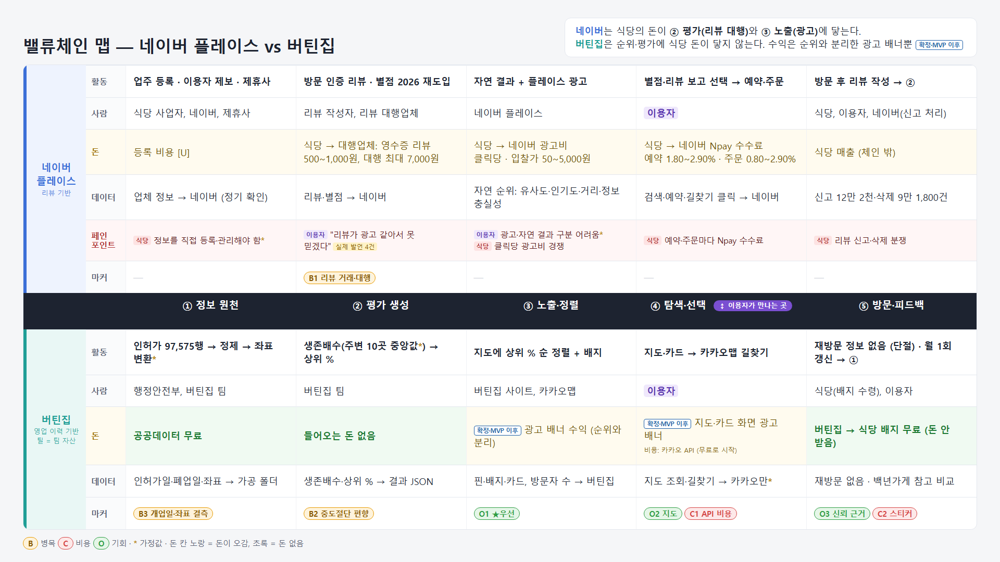
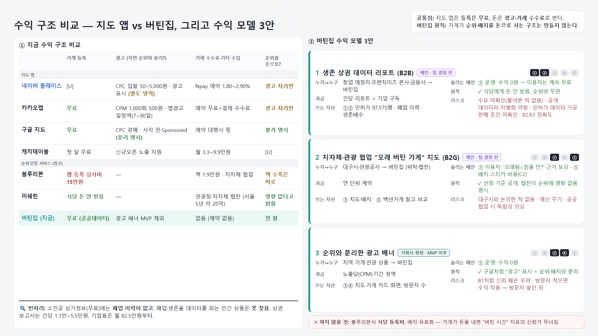
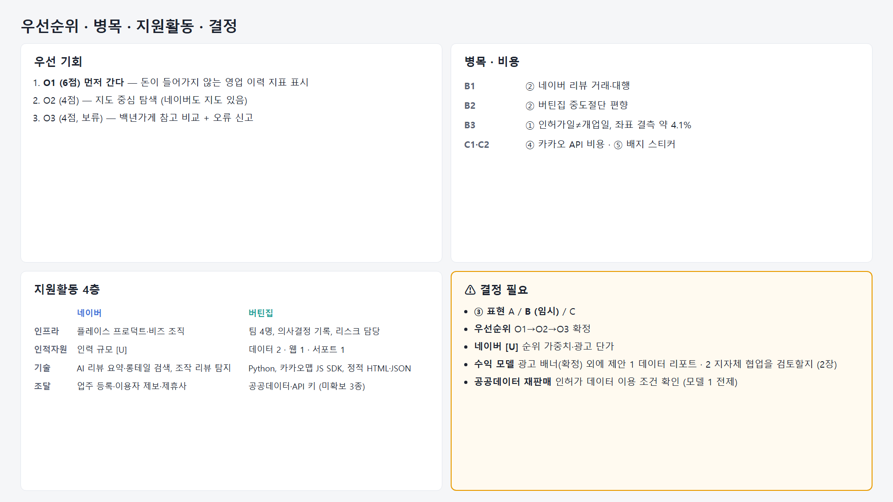
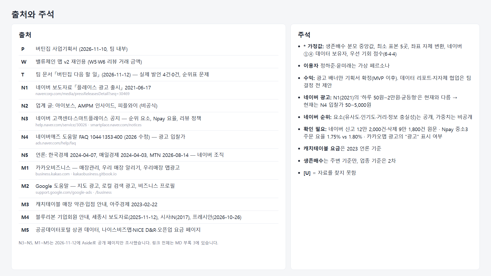

# 밸류체인 맵 — 네이버 플레이스 vs 버틴집

> 발표용 슬라이드(`Day10_v3.3_밸류체인_발표용.html`, 4장)를 글로 옮긴 문서입니다. 자세한 근거와 변경 이력은 `11월 12일 밸류체인 v3.3.md`에 있습니다.

**네이버**는 식당의 돈이 **② 평가(리뷰 대행)**와 **③ 노출(광고)**에 닿는다.
**버틴집**은 순위·평가에 식당 돈이 닿지 않는다. 수익은 순위와 분리한 광고 배너뿐이다 (확정·MVP 이후).

---

## 1장. 밸류체인 맵

### 네이버 플레이스 (리뷰 기반)

| | ① 정보 원천 | ② 평가 생성 | ③ 노출·정렬 | ④ 탐색·선택 | ⑤ 방문·피드백 |
|---|---|---|---|---|---|
| **활동** | 업주 등록 · 이용자 제보 · 제휴사 | 방문 인증 리뷰 · 별점 2026 재도입 | 자연 결과 + 플레이스 광고 | 별점·리뷰 보고 선택 → 예약·주문 | 방문 후 리뷰 작성 → ② |
| **사람** | 식당 사업자, 네이버, 제휴사 | 리뷰 작성자, 리뷰 대행업체 | 네이버 플레이스 | 이용자 | 식당, 이용자, 네이버(신고 처리) |
| **돈** | 등록 비용 [U] | 식당 → 대행업체: 영수증 리뷰 500~1,000원, 대행 최대 7,000원 | 식당 → 네이버 광고비, 클릭당 · 입찰가 50~5,000원 | 식당 → 네이버 Npay 수수료, 예약 1.80~2.90% · 주문 0.80~2.90% | 식당 매출 (체인 밖) |
| **데이터** | 업체 정보 → 네이버 (정기 확인) | 리뷰·별점 → 네이버 | 자연 순위: 유사도·인기도·거리·정보 충실성 | 검색·예약·길찾기 클릭 → 네이버 | 신고 12만 2천·삭제 9만 1,800건 |
| **페인포인트** | 식당: 정보를 직접 등록·관리해야 함* | 이용자: "리뷰가 광고 같아서 못 믿겠다" (실제 발언 4건) | 이용자: 광고·자연 결과 구분 어려움* / 식당: 클릭당 광고비 경쟁 | 식당: 예약·주문마다 Npay 수수료 | 식당: 리뷰 신고·삭제 분쟁 |
| **마커** | — | B1 리뷰 거래·대행 | — | — | — |

### 버틴집 (영업 이력 기반)

| | ① 정보 원천 | ② 평가 생성 | ③ 노출·정렬 | ④ 탐색·선택 ↕ 이용자가 만나는 곳 | ⑤ 방문·피드백 |
|---|---|---|---|---|---|
| **활동** | 인허가 97,575행 → 정제 → 좌표 변환* | 생존배수(주변 10곳 중앙값*) → 상위 % | 지도에 상위 % 순 정렬 + 배지 | 지도·카드 → 카카오맵 길찾기 | 재방문 정보 없음 (단절) · 월 1회 갱신 → ① |
| **사람** | 행정안전부, 버틴집 팀 | 버틴집 팀 | 버틴집 사이트, 카카오맵 | 이용자 | 식당(배지 수령), 이용자 |
| **돈** | 공공데이터 무료 | 들어오는 돈 없음 | **[확정·MVP 이후]** 광고 배너 수익 (순위와 분리) | **[확정·MVP 이후]** 지도·카드 화면 광고 배너 / 비용: 카카오 API (무료로 시작) | 버틴집 → 식당 배지 무료 (돈 안 받음) |
| **데이터** | 인허가일·폐업일·좌표 → 가공 폴더 | 생존배수·상위 % → 결과 JSON | 핀·배지·카드, 방문자 수 → 버틴집 | 지도 조회·길찾기 → 카카오만* | 재방문 없음 · 백년가게 참고 비교 |
| **마커** | B3 개업일·좌표 결측 | B2 중도절단 편향 | O1 ★우선 | O2 지도 · C1 API 비용 | O3 신뢰 근거 · C2 스티커 |

B 병목 · C 비용 · O 기회 · * 가정값

---

## 2장. 수익 구조 비교 — 지도 앱 vs 버틴집, 그리고 수익 모델 3안

- **공통점:** 지도 앱은 등록은 무료, 돈은 광고·거래 수수료로 번다.
- **버틴집 원칙:** 가게가 순위·배지를 돈으로 사는 구조는 만들지 않는다.

### ① 지금 수익 구조 비교

| | 가게 등록 | 광고 (자연 순위와 분리?) | 거래 수수료·기타 수입 | 순위를 돈으로? |
|---|---|---|---|---|
| **지도 앱** | | | | |
| 네이버 플레이스 | [U] | CPC 입찰 50~5,000원 · 광고 표시 (별도 영역) | Npay 예약 1.80~2.90% | 광고 자리만 |
| 카카오맵 | 무료 | CPM 1,000회 500원 · 맵광고 일정액(7~90일) | 예약 무료 + 결제 수수료 | 광고 자리만 |
| 구글 지도 | 무료 | CPC 경매 · 사각 핀·Sponsored (분리 명시) | 예약 대행사 몫 | 불가 명시 |
| 캐치테이블 | 첫 달 무료 | 신규오픈 노출 지원 | 월 3.3~9.9만원 | [U] |
| **순위·인증 서비스 (참고)** | | | | |
| 블루리본 | 웹 등록 심사비 15만원 | — | 책 1.9만원 · 지자체 협업 | 책 수록은 따로 |
| 미쉐린 | 식당 돈 안 받음 | — | 관광청·지자체 협찬 (서울 5년 약 20억) | 영향 없다고 밝힘 |
| **버틴집 (지금)** | 무료 (공공데이터) | 광고 배너 MVP 제외 | 없음 (예약 없음) | 안 함 |

🔍 **빈자리:** 소진공 상가정보(무료)에는 **폐업 이력이 없고**, 폐업·생존율 데이터를 파는 민간 상품은 **못 찾음**. 상권 보고서는 건당 1.1만~5.5만원, 기업용은 월 82.5만원부터.

### ② 버틴집 수익 모델 3안

| | 1. 생존 상권 데이터 리포트 (B2B) | 2. 지자체·관광 협업 "오래 버틴 가게" 지도 (B2G) | 3. 순위와 분리한 광고 배너 |
|---|---|---|---|
| **상태** | 제안 · 팀 결정 전 | 제안 · 팀 결정 전 | **기획서 확정 · MVP 이후** |
| **쓰는 단계** | ①② | ③⑤ | ③④ |
| **누가 → 누구** | 창업 예정자·프랜차이즈 본사·금융사 → 버틴집 | 대구시·관광공사 → 버틴집 (위탁·협찬) | 지역 가게·관광 상품 → 버틴집 |
| **과금** | 건당 리포트 + 기업 구독 | 연 단위 계약 | 노출당(CPM)·기간 정액 |
| **쓰는 자산** | ①② 인허가 97,575행 · 폐업 이력 · 생존배수 | ③ 지도·배지 · ⑤ 백년가게 참고 비교 | ③④ 지도·가게 카드 화면, 방문자 수 |
| **풀리는 페인** | ⑤ 운영: 수익 0원 → 이용자는 계속 무료 | ③ 이용자: '오래됨=믿을 만?' 근거 보강 · ⑤ 배지 스티커 비용(C2) | ⑤ 운영: 수익 0원 |
| **원칙** | ✓ 식당에게 돈 안 받음, 순위와 무관 | ✓ 선정 기준 공개, 협찬이 순위에 영향 없음 명시 | ✓ 구글처럼 "광고" 표시 + 순위·배지와 분리 |
| **리스크** | 수요 미확인(물어본 적 없음) · 공개 데이터라 차별화 약함 · 인허가 데이터 가공 판매 조건 미확인 · B2·B3 정확도 | 대구시와 논의한 적 없음 · 예산 주기 · 공공 협업 시 독립성 의심 | B1처럼 신뢰 훼손 우려 · 방문자 적으면 수익 작음 → 방문자 쌓인 뒤 |

✕ **하지 않을 것:** 블루리본식 **식당 등록비**, 배지 유료화 — 가게가 돈을 내면 "버틴 시간" 지표의 신뢰가 무너짐

---

## 3장. 우선순위 · 병목 · 지원활동 · 결정

### 우선 기회
1. **O1 (6점) 먼저 간다** — 돈이 들어가지 않는 영업 이력 지표 표시
2. O2 (4점) — 지도 중심 탐색 (네이버도 지도 있음)
3. O3 (4점, 보류) — 백년가게 참고 비교 + 오류 신고

### 병목 · 비용
| | |
|---|---|
| B1 | ② 네이버 리뷰 거래·대행 |
| B2 | ② 버틴집 중도절단 편향 |
| B3 | ① 인허가일≠개업일, 좌표 결측 약 4.1% |
| C1·C2 | ④ 카카오 API 비용 · ⑤ 배지 스티커 |

### 지원활동 4층
| | 네이버 | 버틴집 |
|---|---|---|
| 인프라 | 플레이스 프로덕트·비즈 조직 | 팀 4명, 의사결정 기록, 리스크 담당 |
| 인적자원 | 인력 규모 [U] | 데이터 2 · 웹 1 · 서포트 1 |
| 기술 | AI 리뷰 요약·롱테일 검색, 조작 리뷰 탐지 | Python, 카카오맵 JS SDK, 정적 HTML·JSON |
| 조달 | 업주 등록·이용자 제보·제휴사 | 공공데이터·API 키 (미확보 3종) |

### ⚠ 결정 필요
- **③ 표현** A / **B (임시)** / C
- **우선순위** O1 → O2 → O3 확정
- **네이버 [U]** 순위 가중치·광고 단가
- **수익 모델** 광고 배너(확정) 외에 제안 1 데이터 리포트 · 2 지자체 협업을 검토할지
- **공공데이터 재판매** 인허가 데이터 이용 조건 확인 (모델 1 전제)

---

## 4장. 출처와 주석

### 출처
| ID | 자료 |
|---|---|
| P | 버틴집 사업기획서 (2026-11-10, 팀 내부) |
| W | 밸류체인 맵 v2 재인용 (W5·W6 리뷰 거래 금액) |
| T | 팀 문서 「버틴집 다음 할 일」 (2026-11-12) — 실제 발언 4건·0건, 순위표 문제 |
| N1 | 네이버 보도자료 「플레이스 광고 출시」 2021-06-17 — navercorp.com/media/pressReleasesDetail?seq=30469 |
| N2 | 업계 글: 아이보스, AMPM 인사이드, 피플와이 (비공식) |
| N3 | 네이버 고객센터·스마트플레이스 공지 — 순위 요소, Npay 요율, 리뷰 정책 |
| N4 | 네이버애즈 도움말 FAQ 1044·1353·400 (2026 수정) — 광고 입찰가 |
| N5 | 언론: 한국경제 2024-04-07, 매일경제 2024-04-03, MTN 2026-08-14 — 네이버 조직 |
| M1 | 카카오비즈니스 — 매장관리, 우리 매장 알리기, 우리매장 맵광고 |
| M2 | Google 도움말 — 지도 광고, 로컬 검색 광고, 비즈니스 프로필 |
| M3 | 캐치테이블 매장 약관·입점 안내, 아주경제 2023-02-22 |
| M4 | 블루리본 기업회원 안내, 세종시 보도자료(2025-11-12), 시사IN(2017), 프레시안(2026-10-26) |
| M5 | 공공데이터포털 상권 데이터, 나이스비즈맵·NICE D&R·오픈업 요금 페이지 |

N3~N5, M1~M5는 2026-11-12에 Aside로 공개 페이지만 조사했습니다. 링크 전체는 `11월 12일 밸류체인 v3.3.md` 부록 3에 있습니다.

### 주석
- **\* 가정값:** 생존배수 분모 중앙값, 최소 표본 5곳, 좌표 자체 변환, 네이버 ①④ 데이터 보유자, 우선 기회 점수(6·4·4)
- **이용자** 정하준·윤미래는 가상 페르소나
- **수익:** 광고 배너만 기획서 확정(MVP 이후). 데이터 리포트·지자체 협업은 팀 결정 전 제안
- **네이버 광고:** N1(2021)의 '하루 50원~2만원·균등형'은 현재와 다름 → 현재는 N4 입찰가 50~5,000원
- **네이버 순위:** 요소(유사도·인기도·거리·정보 충실성)는 공개, 가중치는 비공개
- **확인 필요:** 네이버 신고 12만 2,000건·삭제 9만 1,800건 원문 · Npay 중소3 주문 요율 1.75% vs 1.80% · 카카오맵 광고의 "광고" 표시 여부
- **캐치테이블 요금**은 2023 언론 기준
- **생존배수**는 주변 기준만, 업종 기준은 2차
- **[U]** = 자료를 찾지 못함
