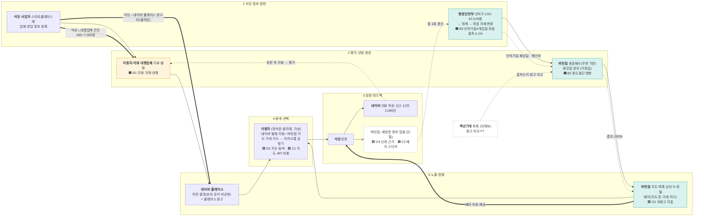
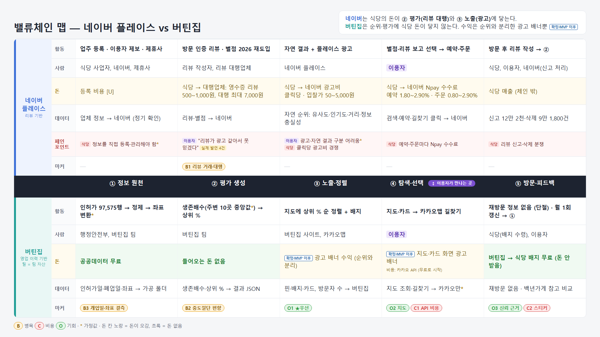
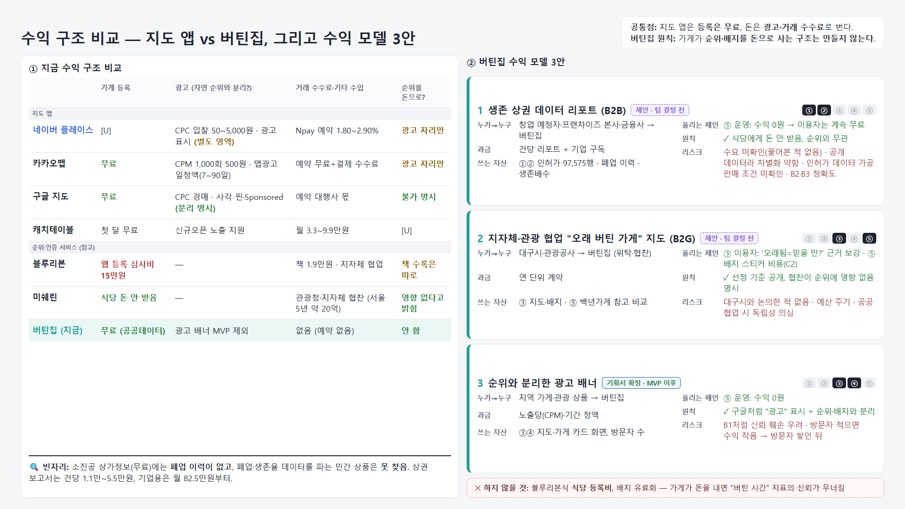
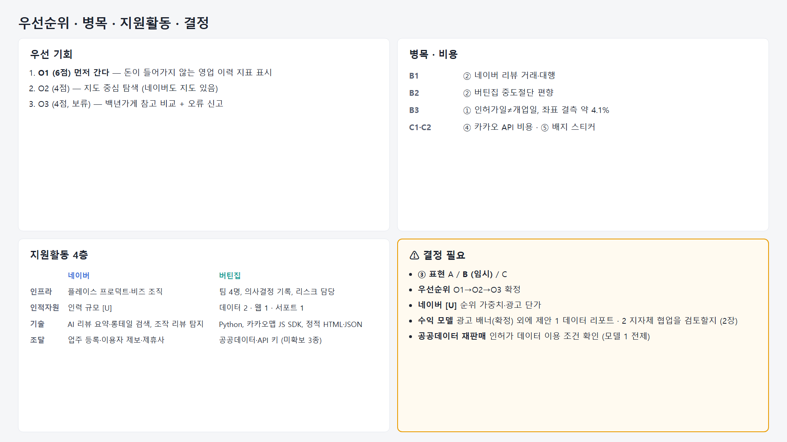
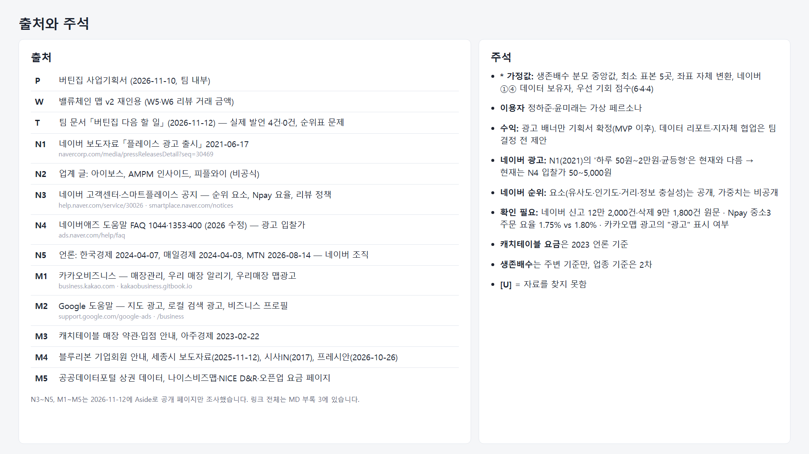

# Day 10 (v3) — 밸류체인 맵: 식당 탐색 체인 비교 (네이버 플레이스 vs 버틴집)

작성일 2026-11-12 (v3.3) · 입력: `11월 10일 버틴집 사업기획서 (1).md`(P), `11월 11일 밸류체인.md`(v2, W 번호 재인용), 웹 자료 N1~N5(부록 3) · 이름은 입력 자료에 나온 것만 · 금액·비율은 원문 값만(계산값은 "계산값"으로 표시)
표기: [F] 원문 사실 / **(가정값)** 제가 임의로 정한 값 — 추후 구체화 예정 / [U] 미확인 / ⚠결정 / ~~점선~~ = MVP 이후(2차)
**구조**: 같은 5단계 위에 **네이버 플레이스 체인(위)**과 **버틴집 체인(아래)**을 나란히 놓는다. 두 체인은 ④ 단계의 **이용자**에서 만난다. 백년가게는 경쟁 체인이 아니라 **참고 비교 대상**이다. 국가(중소벤처기업부)가 지정한 가게이므로, 버틴집 상위 가게와 겹치는 곳이 있으면 버틴집 결과의 신빙성이 높아진다고 본다(사용자 설명 11/12). 맞고 틀림을 판정하는 "검증 기준"은 아니다.
**범위**: **MVP 기준**(사용자 결정 11/12). 업종 기준 생존배수·광고 배너·즐겨찾기 등 2차 항목은 점선으로만 표시한다.
**팀 자산(틸)** = 대구 일반음식점 인허가 데이터(97,575행)와 생존배수(P 3-2, 6-1).

### v2 → v3 변경 이력
| # | 바뀐 것 | 이유 |
|---|---|---|
| 1 | 비교 대상 캐치테이블 → **네이버 플레이스** | 사용자 결정(11/12). 문제 정의(P 2-1 광고 리뷰)와 근거(P 2-2 신고 12만 2,000건)가 네이버 플레이스에 대한 것 |
| 2 | Day 9 "경쟁사 없음" 결정을 대체 | 기획서 10-3에 경쟁 서비스가 있음. 네이버 플레이스를 비교 기준으로 둔다 |
| 3 | 백년가게를 **참고 비교 대상**으로 추가 (v3.1에서 "검증 기준" → "참고 비교"로 수정) | 국가 지정 가게와 겹치면 신빙성이 높아진다는 취지(사용자 설명 11/12). P 10-2, F7 |
| 4 | ② 생존배수를 기획서 7-2 기준으로 갱신 | 중앙값 분모, ε 평탄화, 30일 하한, MVP는 주변 기준만(P 12-2) |
| 5 | ① 정제·좌표 변환 단계, ③ 배지, ⑤ 피드백 고리 추가 | P 9-1, 11-2-1, 6-4·14-2 |
| 6 | 광고 배너를 MVP 제외(점선)로 변경 | P 12-1 |
| 7 | 데이터 ③ 근거 P 14-1 → **P 14-2** | 출처 번호 오류 수정 |
| 8 | 페르소나에 "가상" 표시 | P 4 |
| 9 | 마커 재구성: 중도절단(B2) 추가, 캐치테이블 비용 마커 삭제 | R5가 발생 가능성 "높음". 경쟁사 비용은 버틴집이 실행할 수 있는 내용이 아님 |
| 10 | "(미정)" 표기를 "(가정값)"으로 통일 | 사용자 요청(Q4) |
| 11 | 제목 "음식점 추천 체인" → "식당 탐색 체인" | ③ 표현은 ⚠결정 1의 3개 안 중 선택 전까지 **안 B(지표 기반 정렬)**를 임시로 적용 |
| 12 | (v3.1) 네이버 돈·③ 칸 보강: 플레이스 광고(클릭당 과금, 플레이스 영역·지도 노출) | 웹 자료 N1(네이버 보도자료). 자연 순위 기준은 비공개 [U] |
| 13 | (v3.2) 팀원 이름 삭제(역할로 표기), 맵을 세로 비교형(단계=행, 네이버\|버틴집=열)으로 변경 | 사용자 요청 |
| 14 | (v3.3) 맵 HTML을 16:9(1920×1080) 한 장 표로 재구성: 가로 ①~⑤ 단계, 세로 네이버/버틴집 × 활동·사람·돈·데이터·마커·출처. 단계 줄을 두 체인 사이에 두고 ④에 "이용자가 만나는 곳" 표시. 칸을 누르면 전체 설명 팝업 | 사용자 요청 (맵이 보기 힘듦, 발표용 16:9) |
| 15 | (v3.3) 맵 ④ 네이버: "광고 리포트" 내용을 돈 칸 → 데이터 칸으로 이동, 데이터 보유자에 (가정값) 표시 | 돈이 아니라 데이터 항목. 가정값 목록과 일치 |
| 16 | (v3.3) 맵 ⑤ 네이버 신고 수치에 "원문 수치 확인 필요" 표시, ① B3 "4.1%" → "약 4.1%" | 3교시 신호 표·원문 표기와 일치 |
| 17 | (v3.3) 맵 돈 칸: 버틴집 ⑤ 배지 무료를 초록(돈 안 받음)으로 수정, 버틴집 ④에 "이후 비용 가능", 네이버 ④에 "= ③ 광고비와 같은 돈" 표시, 네이버 ② 금액을 "영수증 리뷰 500~1,000원 · 대행 최대 7,000원"으로 분리. 범례를 "노랑 = 돈이 오가거나 비용이 생길 수 있음"으로 보완 | 검토 지적: 색 오류, 돈 흐름 중복으로 읽힘, 원문 수치와 다른 범위 |
| 18 | (v3.3) 맵에 출처 줄 추가(PNG·인쇄에도 근거가 남도록), 사람 칸에 영향 요인, "업종 기준 2차", "틸 = 버틴집 자산", N1 "2021 자료, 현재와 다를 수 있음" 표시 | 검토 지적: 팝업에만 있던 근거·누락 정보 |
| 19 | (v3.3) 맵 HTML 기술 정리: 키보드(Enter/Space)로 칸 열기, Esc로 닫기, 안 쓰는 CSS 삭제, 작은 화면에서는 0.6배 이하로 줄지 않고 스크롤 | 검토 지적 |
| 20 | (v3.3) 네이버 [U] 칸 보강: 자연 순위 요소, 현재 광고 과금(입찰가 50~5,000원), Npay 수수료·예약/주문 이용료, 리뷰 정책(방문 인증·별점 2026 재도입·대가성 리뷰 제재), 지원활동 4층. 맵 ④ 네이버 돈을 Npay 수수료로 변경(광고 클릭 과금은 ③) | Aside 웹 조사(11/12, 공개 페이지만), 부록 3 N3~N5 |
| 21 | (v3.3) 5교시 추가: 단계별 페인포인트(이용자·식당·운영), 지도 앱 수익 구조 비교, 버틴집 수익 모델 3안. 맵 HTML을 3장 슬라이드로 나눔(1 맵+페인포인트 줄, 2 수익, 3 우선순위·결정) | 사용자 요청(페인포인트가 안 보임, 수익 모델 비교). Aside 웹 조사 M1~M5, 팀 문서 T |
| 22 | (v3.3) 맵 1장: 버틴집 페인포인트 줄 삭제(네이버만 표시), 버틴집 돈 줄을 '무료·돈 없음' 대신 계획 수익(모델 1 데이터 리포트, 모델 3 분리 광고, 모델 2 지자체 협업)으로 표시하고 '계획' 점선 표시, 맨 위 요약 문구 수정 | 사용자 요청 |
| 23 | (v3.3) 맵 1장 버틴집 ⑤ 칸의 빗금(단절 표시) 삭제. 단절은 ⑤ 활동 칸 문구 "재방문 정보 없음 (단절)"로만 표시 | 사용자 요청 |
| 24 | (v3.3) 수익 표시를 확정/제안으로 구분: 광고 배너 = 기획서 확정(P 11-2, MVP 이후), 데이터 리포트·지자체 협업 = 제안(팀 결정 전). 맵을 두 버전으로 만듦 — A `Day10_v3.3_밸류체인.html`(확정·제안 함께 표시), B `Day10_v3.3_밸류체인_발표용.html`(돈 줄에 기획서 확정분만, 나머지는 무료·돈 없음) | 사용자 요청: 판매안이 애매함, 결정 근거 확인 |
| 25 | (v3.3) 발표에는 B(광고만)를 쓰기로 함 → `Day10_v3.3_밸류체인_발표용.html`과 PNG 3장(`_발표용_1~3.png`). A는 작업용으로 유지 | 사용자 결정 11/12 |
| 26 | (v3.3) 발표용 정리: 출처를 4장 '출처와 주석'으로 모음(1~3장의 출처 줄·출처 코드·범례 출처 삭제), 제목에서 버전 표기 삭제, 부제·안내 문구·'(가상)'·'확인 필요'·'영향:' 줄·'업종 기준 2차'·'(비교: …)' 등 작은 글자 삭제. 지운 주의 사항(가정값, 가상 페르소나, 확인 필요, 2021 자료 등)은 4장 주석으로 옮김. 1장에는 색·마커 설명 한 줄만 남김. 작업용 A는 그대로 | 사용자 요청 |

---

## 1교시 — 활동 발산

### 주활동 5단계 (두 체인 공통 이름)
| 단계 | 네이버 플레이스 체인 | 버틴집 체인 (MVP) |
|---|---|---|
| ① 식당 정보 원천 | 업체 정보·영업 정보 [F, P 10-3]. 업주가 스마트플레이스에 등록 (광고를 하려면 등록 필요, N2). 이용자의 '신규 장소 등록' 제보, 제휴사(NOL, 여기어때, 세스코, 소상공인진흥원, 다이닝코드 등) 정보도 반영. 업체명·주소·전화번호를 정기 모니터링하고 폐업 등이 확인되면 노출 일시정지 [F, N3] | 행정안전부 일반음식점 인허가 CSV 97,575행 [F, P 6-1] → 정제(중복 837그룹 1,946행 정리, 영업시작일 결측 14건 제외) [F, P 3-6] → 좌표 변환 EPSG5174→WGS84, **자체 변환** (가정값), 결측 3,990건(약 4.1%) [F, P 6-3] |
| ② 평가·선정 생성 | 이용자 리뷰·별점 [F, P 10-3]. 영수증·카드 결제내역·네이버 예약으로 방문 인증(2024-01 공지). 별점은 2021-10 폐지 → 2026-04-06 방문분부터 다시 입력, 2026-07-09부터 표시 [F, N3]. 대가성 허위 리뷰는 1회 적발 시 업체 단위 제재(2026-01-28 공지) [F, N3]. 영수증 리뷰 거래 건당 500~1,000원, 대행 최대 건당 7,000원 [F, W5·W6 재인용]. "좋은 리뷰 10건에 4만원" 대행 거래 지적(일부 플랫폼) [F, P 2-2] | 생존배수(주변 기준) = 영업연수 ÷ 가까운 폐업 점포 10곳 영업연수의 **중앙값** (가정값) [P 7-2]. 30일 하한, ε 평탄화(값 (가정값) 미정), 최소 표본 5곳 (가정값) [P 7-3] → 백분위(상위 %) [F, P 7-4]. ~~업종 기준(2차)~~ |
| ③ 노출·정렬 | 검색 결과 '플레이스' 영역과 네이버 지도에 **자연 결과 + 플레이스 광고**가 함께 노출 [F, N1, N4]. 자연 순위 요소는 공개: 유사도(적합도·연관도)·인기도·거리·정보의 충실성 + 어뷰징 모니터링 [F, N3]. 요소별 가중치·계산식은 비공개 [U]. 페르소나 시나리오: "상위 결과는 최근 개업한 SNS 맛집" (가상, P 4-1) | 지도 중심 화면에 "버틴집 기준 상위 N%" 지표와 설명 문구 표시, **상위 % 순 정렬**(F2). 배지를 지도 핀·가게 카드에 무료 표시 [F, P 8-2, 11-2-1]. 중도절단 한계 문구 표시 [F, P 3-3] |
| ④ 탐색·선택 | 별점·리뷰로 식당 선택 [F, P 4-1 페르소나 행동, 가상] | 지도·목록 탐색 → 가게 카드(영업기간, 상위 %, 영업시간·메뉴는 "없음" 표시) → 카카오맵 길찾기 [F, P 8-1, 12-1]. 예약 없음 [F, P 5] |
| ⑤ 방문·피드백 | 방문 후 리뷰 작성 → ②로 돌아감 (영수증 리뷰 존재로 추정, 가정값). 권리침해 신고 12만 2,000건 중 9만 1,800건(약 75%) 삭제 [F, P 2-2] | 방문(체인 밖). 재방문 정보 없음 [F, P 3-3의 7번]. 돌아오는 것: 방문자 수 [F, P 14-2], 공개 후 반응 [F, P 14-2], 오류 신고 (창구 미정, P 14-5). 월 1회 갱신으로 ①을 다시 돌림 [F, P 9-1] |

백년가게: 버틴집 결과와 **비교해 보는 참고 대상**(F7, 내부용). 버틴집 상위 가게와 겹치면 신빙성 보강, 안 겹쳐도 버틴집 결과가 틀렸다는 뜻은 아님. 목록은 미확보 [F, P 6-1, R2].

### 지원활동 4층
| 층 | 네이버 플레이스 | 버틴집 |
|---|---|---|
| 기업 인프라 | 2024-04 사내독립기업(CIC) 체제 폐지 → 플레이스는 '플레이스 프로덕트'·'플레이스 비즈' 조직 [언론, N5]. 2026-03 기준 주요 연구개발 조직 중 하나가 '플레이스 프로덕트'(반기보고서 인용 기사) [N5] | 팀 4명, 의사결정 기록(확정·미정·제안 표시) [F, P 14-4]. 리스크 담당 1명 지정 (임의 지정, P 13-3) |
| 인적자원 | 플레이스 검색 총괄·사업 기획 리더 직책 확인 [F, N3 보도자료·DAN24]. 인력 규모 [U] | 역할 4개: 데이터 수집·정리(가게 정보), 웹사이트 제작, 데이터 수집·정리(문제 상황)·기획서, 서포트 [F, P 12-4]. 갱신 담당 미정 [P 14-3] |
| 기술개발 | AI 브리핑(리뷰 AI 요약, 2025-06 정식), 마이크로리뷰(생성형 AI 한 줄 요약), AI 롱테일 검색(음식점 먼저 적용), 조작 영수증 리뷰 자동 탐지('10여 종의 기술') [F, N3] | Python(pandas, pyproj, scipy), 카카오맵 JavaScript SDK, 정적 HTML/JS, 결과 JSON, 정적 호스팅(추정) [F, P 9-2, 9-3] |
| 조달 | 업주 등록 + 이용자 제보 + 제휴사(소상공인진흥원 등). 도로명주소는 정부 도로명주소 안내시스템 기준 [F, N3]. 공공데이터(인허가 등) 사용 여부 [U] | 행안부 공공데이터(무료), 카카오 API 키(발급 필요) [F, P 9-3]. 미확보: 휴게음식점 파일, 메뉴·영업시간, 백년가게 목록(sbiz.or.kr) [F, P 6-1] |

> 네이버 플레이스 지원활동은 Aside 웹 조사(11/12, 공개 페이지만)로 채웠다(부록 3 N3~N5). 조직은 언론 보도 기준이라 비공식이다.

## 2교시 — 단계 5개 · 이해관계자 · 네 층

### 이해관계자 (하는 사람 / 영향 주는 사람)
| 단계 | 네이버 플레이스 체인 | 버틴집 체인 |
|---|---|---|
| ① | **식당 사업자**, **네이버** (영향: 스마트플레이스 등록 N2) | **행정안전부**, **버틴집 팀(데이터 담당)** (영향: 인허가 기준, 재인허가·명의 변경 P 3-3) |
| ② | **리뷰 작성 이용자**, **리뷰 대행업체** (영향: 건당 거래 W5·W6) | **버틴집 팀** (영향: 중도절단·시기 차이 한계 P 3-3, 백년가게 참고 비교 P 10-2) |
| ③ | **네이버 플레이스** (영향: 공정위 추천·보증 심사지침 P 2-2) | **버틴집 사이트(웹 담당)·카카오맵** (영향: 카카오 약관, 공정위 표시·광고 지침 P 6-5, 11-2-1) |
| ④ | **이용자** | **이용자 — 정하준(외지인, 가상)·윤미래(내지인, 가상)** (영향: 광고·체험단 글 P 2-1) |
| ⑤ | **식당**, **이용자**, **네이버**(신고 처리) | **식당**(배지 수령), **이용자** (영향: 백년가게 인증과 혼동 위험 R10) |

여섯 유형 중 원천(행안부)·플랫폼(네이버·버틴집·카카오)·소비자(이용자)·파트너(리뷰 대행업체·카카오)·공공(행안부·공정위) 5유형을 채웠다. "제조·제작"은 식당 탐색 체인에 해당이 약해 비웠다 (가정값).

### ③ 돈 흐름
| | 네이버 플레이스 | 버틴집 |
|---|---|---|
| 시작점 | **식당 → 네이버: 플레이스 광고비**. 등록·노출 무료, 클릭할 때만 과금(CPC). **현재 입찰가 50~5,000원**(VAT 별도, 광고그룹 단위), 일 예산 상한 광고그룹당 10만원. 업체 페이지 이동·전화·예약·저장·길찾기·리뷰 클릭에 과금 [F, N4, 2026 수정]. (출시 당시 2021년에는 하루 50원~2만원·균등형이었음 [N1]) | 이용자 **무료** [F, P 11-1]. 계획 수익(5교시 3안): ①② 생존 상권 데이터 리포트, ③④ 순위와 분리한 "광고" 표시 영역, ⑤ 지자체·관광 협업 — 식당에게는 받지 않음 |
| 체인 안의 돈 | **식당 → 네이버**(위, ③ 노출에 닿음). **식당 → 리뷰 대행업체**: 영수증 리뷰 건당 500~1,000원, 대행 최대 7,000원 [F, W5·W6], 리뷰 10건 4만원 [F, P 2-2]. 이 돈이 ② 평가를 바꾼다 | **버틴집 → 식당**: 배지·인증 스티커 무료 제공(돈을 받지 않음) [F, P 11-2] |
| 부수 | **식당 → 네이버: Npay 수수료**(부가세 별도). 예약 1.80~2.90%, 주문·매장결제 0.80~2.90%(사업자 규모별). 네이버 예약 이용료 없음, 네이버 주문 서비스 사용료 '현재 부과 안 함'(2025-02) [F, N3]. 중소3 주문 요율은 현재 도움말 1.75%, 예전 도움말 1.80%로 다름 — 확인 필요 | ~~광고 배너(MVP 제외, 광고주 [U])~~ [P 12-1] |
| 끝점 | 식당 매출(체인 밖) | 식당 방문 매출(체인 밖) |
| 주요 비용 | [U] | 카카오 API(무료로 시작), 정적 호스팅, 월 1회 갱신 작업 시간, 스티커 제작비(추정) — 금액 [U] [P 11-3] |

원칙: 가게가 돈을 내고 순위를 사는 구조는 피한다. 광고 배너는 순위·배지와 분리한다 [F, P 11-1, 11-2-1]. **네이버 체인은 식당의 돈이 두 곳에 닿는다 — ② 평가(리뷰 대행)와 ③ 노출(플레이스 광고). 버틴집 체인은 ②·③으로 들어오는 돈이 없다.** 이것이 두 체인의 핵심 차이다. (단, 네이버 광고는 광고로 표시되는 정식 상품이고, 리뷰 대행은 표시되지 않는 거래라 성격이 다르다.)

### ④ 데이터 흐름 — 15칸 (5단계 × 데이터 이름 · 생성 지점 · 보유자)
**네이버 플레이스**
| 단계 | 데이터 이름 | 생성 지점 | 보유자 | 근거 |
|---|---|---|---|---|
| ① | 업체·영업 정보 | 업주가 스마트플레이스에 등록 | 네이버 (가정값) | P 10-3, N2 |
| ② | 리뷰·별점 | 방문 후 이용자 작성 | 네이버 | P 10-3, W5 |
| ③ | 자연 순위(요소 공개·가중치 비공개) / 광고 클릭 통계 | 유사도·인기도·거리·정보 충실성 / 광고 클릭 | 네이버 (광고 통계는 광고주도 리포트로 봄) | N1, N3, N4 |
| ④ | 검색·지도 조회, 예약·길찾기 클릭 | 앱 이용 | 네이버 (가정값; 광고 클릭·예약·길찾기 횟수는 광고주도 리포트로 봄) | N1 (광고 리포트 항목) |
| ⑤ | 권리침해 신고·삭제 기록 | 신고 | 네이버 (국회의원실에 제출) | P 2-2 [F] (원문 수치 확인 필요) |

**버틴집**
| 단계 | 데이터 이름 | 생성 지점 | 보유자 | 근거 |
|---|---|---|---|---|
| ① | 인허가일·폐업일·영업상태·X,Y → 정제본·WGS84 좌표 | 행정 인허가 → 정제·자체 변환 | 행정안전부(공개) → 버틴집 가공 폴더 | P 6-1, 9-1, 9-2 [F] |
| ② | 생존배수·상위 % | 계산(주변 KNN k=10, 중앙값 (가정값)) | **버틴집** (결과 JSON) | P 7-2, 9-2 [F] |
| ③ | 지도 핀·배지·가게 카드, 방문자 수 | JSON → 카카오맵 SDK 화면, 사이트 이용 | 버틴집 | P 9-4, **14-2** [F] |
| ④ | 지도 조회·길찾기 | 카카오맵 | 카카오 (버틴집은 보유하지 않음, 가정값) | P 8-1 |
| ⑤ | 재방문 / 오류 신고 | — / 창구 미정 | **없음(단절)** | P 3-3, 14-5 [F] |

**피드백**: 네이버는 ⑤ 리뷰가 ②로 돌아가는 고리가 있지만, 대행 리뷰가 그 고리에 섞인다. 버틴집은 ⑤→② 고리가 없고, 월 1회 갱신으로 ①만 다시 돌린다.
**참고 비교(내부)**: 백년가게 목록과 버틴집 상위 X%가 얼마나 겹치는지 본다(F7, P 7-5). 겹치면 신빙성 보강 자료로 쓴다. 목록 미확보.

## 3교시 — 신호 · 마커 · 우선 기회

### 신호 근거
| 신호 | 단계 | 근거 | 출처 | 짝이 되는 기회 |
|---|---|---|---|---|
| 평가에 돈이 들어감 | ② 네이버 | 영수증 리뷰 건당 500~1,000원, 대행 최대 7,000원, 10건 4만원 | W5·W6, P 2-2 | 돈이 들어가지 않는 근거(영업 이력) |
| 노출에 돈이 들어감 | ③ 네이버 | 플레이스 광고가 플레이스 영역·지도에 노출, 클릭당 과금 (광고 표시가 있는 정식 상품) | N1 | 돈이 들어가지 않는 정렬 |
| 평가 품질 편차 | ⑤ 네이버 | 신고 12만 2,000건, 삭제 9만 1,800건(약 75%), 2023~2025.8 | P 2-2 (원문 수치 확인 필요) | 대체 신호 |
| 지표 편향 | ② 버틴집 | 중도절단: 영업 중 점포 배수가 구조적으로 높음 (발생 가능성 높음) | P 3-3의 1번, R5 | 한계 표시 |
| 정보 정확도 | ① 버틴집 | 인허가일 ≠ 실제 개업일 가능성, 좌표 결측 약 4.1% | P 3-3의 2번, 6-3 | 데이터 정제 |
| 중간 비용 | ④ 버틴집 | 카카오 API 비용·호출 한도(무료 시작, 단가 [U]) | P R8, 11-3 | — |
| 중간 비용 | ⑤ 버틴집 | 무료 배지 스티커 제작비(추정) | P 11-3 | — |
| 데이터 단절 | ⑤ 버틴집 | 재방문 정보가 돌아오지 않음 | P 3-3의 7번 | 검증 |
| 대기·지연 | — | 근거 없음 → 마커 안 만듦 | — | — |

### 마커 8개 (병목 3 · 비용 2 · 기회 3)
| ID | 종류 | 단계 | 대상 | 내용 | 근거 |
|---|---|---|---|---|---|
| B1 | 병목 | ② | 네이버 | 리뷰 거래·대행으로 평가 근거에 돈이 섞임 | W5·W6, P 2-2 [F, 보도] — 영향의 크기는 [U] |
| B2 | 병목 | ② | 버틴집 | 중도절단 편향 — 영업 중 점포 배수가 높게 나옴 | P 3-3, R5 [F] |
| B3 | 병목 | ① | 버틴집 | 인허가일 ≠ 실제 개업일, 좌표 결측 약 4.1% | P 3-3, 6-3 [F] |
| C1 | 비용 | ④ | 버틴집 | 카카오 지도 API 호출 비용(무료 시작, 단가 [U]) | P R8, 11-3 [F, 계획] |
| C2 | 비용 | ⑤ | 버틴집 | 무료 배지·스티커 제작비 | P 11-3 [추정] |
| O1 | 기회 | ③ | 버틴집 | 돈이 들어가지 않는 영업 이력 지표("버틴집 기준 상위 N%")를 지도·카드에 표시 | P 7-4, 11-2-1 |
| O2 | 기회 | ④ | 버틴집 | 지도 중심 탐색(확정). 네이버 플레이스도 지도가 있어 → 경쟁 지점 | P 8-2, 10-3 |
| O3 | 기회 | ⑤ | 버틴집 | 신뢰 근거 만들기: 백년가게와 겹치는지 참고 비교 + 오류 신고·재방문으로 "생존=인정" 가정 확인 | P 3-3, 7-5, 14-5 |

단계별 마커: ① B3 · ② B1, B2 · ③ O1 · ④ C1, O2 · ⑤ C2, O3 (단계당 최대 2개 준수).
v2의 B1(블루리본)·C1(캐치테이블 급여·지급수수료)은 비교 대상이 바뀌어 삭제했다.

### 우선 기회 매트릭스 (영향·실현 가능성 각 1~3 — **(가정값), 제 판단**)
| 기회 | 영향 | 실현 가능성 | 합 | 사분면 |
|---|---|---|---|---|
| O1 비광고 지표 표시 | 3 (문제 정의에 직접 대응) | 3 (CSV 보유, Python, 정적 파일) | 6 | **먼저 간다** |
| O2 지도 탐색 | 2 (네이버도 지도 있음) | 2 (카카오 API 키 발급 필요) | 4 | 빠른 성과 |
| O3 신뢰 근거 (백년가게 참고 비교 등) | 3 (신뢰 근거) | 1 (백년가게 목록·재방문 데이터 없음) | 4 | 보류 → 목록 확보 시 2로 상향 |

**우선 기회: O1 (가정값).** B2 중도절단 한계 문구를 O1 화면에 함께 표시한다.

## 4교시 — 검증 → v3

### 초안이 자주 틀리는 6자리 점검
| 점검 | 결과 |
|---|---|
| 일반론 단계 | "정보 원천 → 평가·선정 → 노출·정렬 → 탐색·선택 → 방문·피드백"으로 두 체인에 같게 맞췄다 |
| 이름 없는 상자 | 네이버 플레이스·행정안전부·카카오·백년가게는 실명. 리뷰 대행업체의 업체명은 [U]. 팀원은 이름 대신 역할로(v3.2), 이용자는 가상 페르소나로 표시 |
| 단계 누락·과잉 | 버틴집 ①에 정제·좌표 변환을 넣었다(P 9-1). 네이버 ① 이전 단계는 근거가 없어 넣지 않음 |
| 수치 환각 | 금액·건수는 P 2-2, 3-6, 6-3과 W5·W6(v2 재인용)의 원문 값. "약 75%", "약 4.1%"는 원문 표기 |
| 지역 맥락 | 대구 인허가 데이터를 틸로 표시. 네이버 체인은 전국 서비스라 대구 한정 근거 없음 [U] |
| 마커 남발 | 8개, 단계당 최대 2개, 근거 없는 신호(대기·지연) 제외 |

### 가정값 목록 (Q4 — 추후 구체화)
| 항목 | 가정값 | 이유 | 기획서 안의 다른 표기 |
|---|---|---|---|
| 생존배수 분모 | **중앙값** | 7-2가 회의록 6번 결정을 반영한 최신 계산 방식 | 3-2·15-2는 "평균" → 기획서 수정 필요 |
| 좌표 | **자체 변환(EPSG5174→WGS84, pyproj)** | 6-1·9-1·9-3이 모두 자체 변환. 카카오 API 호출을 줄임(C1) | 3-2는 "카카오 로컬 API" → 기획서 수정 필요 |
| 기준일 | 2026-10-28 | 6-2 고정값 | 데이터 최신일 2026-10-26 (P 3-6) |
| 최소 표본 | 5곳 | 7-3 추정값 | — |
| ε | 미정 | 7-2 | — |
| 네이버 ①·④ 보유자 | 네이버 | 입력 자료에 없음 | — |
| 카카오 길찾기 데이터 보유 | 카카오만 | 버틴집은 길찾기 링크만 넘김 | v2는 "카카오·버틴집" |

### 이 단계의 한계
- 네이버 플레이스 체인은 기획서(10-3, 2-2), W5·W6, 웹 자료 N1~N5로 만들었다. N3~N5는 Aside가 11/12 공개 페이지에서 조사한 결과이며, 고객센터 도움말 대부분은 작성일 표시가 없다. 남은 [U]: 순위 요소별 가중치, 광고 실제 평균 단가, 플레이스 인력 규모, 공공데이터 사용 여부, Npay 중소3 주문 요율(1.75% vs 1.80%).
- W5·W6은 v2 맵 84행에서 재인용했다. 원페이지(W) 원문은 이번 입력에 없어 직접 확인하지 못했다.
- 이용자가 두 서비스를 병행해 쓴다는 연결(④)은 페르소나(가상) 행동에서 나온 것이다. 확인된 자료는 없다.

## 5교시 — 페인포인트 · 수익 구조 (11/12 추가)

### 단계별 페인포인트 — 네이버 플레이스 (누가 불편한가)
표기: 이용자 / 식당. 버틴집 체인의 페인포인트는 맵에서 뺐다(사용자 결정 11/12). 버틴집 쪽 문제는 마커 B2·B3·C1·C2와 `1112팀프로젝트/버틴집_다음할일.md`에서 관리한다. T = 팀 문서 `1112팀프로젝트/버틴집_다음할일.md`(11/12).

| 단계 | 네이버 플레이스 |
|---|---|
| ① | 식당: 정보를 직접 등록·관리해야 노출·광고 가능 (부담 정도는 가정값) |
| ② | 이용자: "리뷰가 광고 같아서 못 믿겠다" — **실제 발언 4건** [T 2-1]. 식당: 대가성 리뷰 1회 적발 시 업체 단위 제재 위험 [N3] |
| ③ | 이용자: 광고와 자연 결과가 섞여 구분이 어려움 (가정값). 식당: 클릭당 광고비 경쟁(입찰가 50~5,000원) [N4] |
| ④ | 식당: 예약·주문마다 Npay 수수료(예약 1.80~2.90%, 주문 0.80~2.90%) [N3] |
| ⑤ | 식당·이용자: 권리침해 신고 12만 2,000건 중 9만 1,800건(약 75%) 삭제 — 리뷰 분쟁 [P 2-2, 원문 확인 필요] |

### 수익 구조 비교 (Aside 웹 조사 11/12, 공개 페이지만 — 부록 3 M1~M5)
| 서비스 | 가게 등록 | 광고 (자연 순위와 분리?) | 거래 수수료·기타 수입 | 순위를 돈으로? |
|---|---|---|---|---|
| 네이버 플레이스 | [U] | CPC 입찰 50~5,000원, 광고 표시 [N4] | Npay 예약 1.80~2.90% [N3] | 광고 자리만 |
| 카카오맵 | 무료 [M1] | '우리 매장 알리기' CPM 1,000회 노출당 500원, '우리매장 맵광고' 일 정액(7~90일, 지도 한 화면 최대 3개) [M1]. "광고" 표시·순위 영향 여부는 못 찾음 | 카카오톡 예약하기 무료 + 결제 수수료(요율 못 찾음) [M1] | 광고 자리만 |
| 구글 지도 | 무료 [M2] | 지도 광고 4종, CPC 경매. 프로모션 핀은 사각 핀·"Sponsored"로 구분, 로컬 광고는 자연 노출과 다르다고 명시 [M2] | Reserve with Google — 예약 대행사가 받음 [M2] | "돈을 내고 순위를 올릴 방법은 없다"고 명시 [M2] |
| 캐치테이블 | 첫 1개월 무료 [M3] | '신규오픈맛집 노출 지원' 혜택 [M3] | 월 이용료 예약 건수 구간제 3만3000~9만9000원 (2023 언론, 현재 요금 미확인) [M3] | [U] |
| 블루리본 (참고) | **웹 등록 심사비 업소당 15만원**(부가세 별도), 책 수록은 보장 안 함 [M4] | — | 책 『서울의 맛집 2027』 1만9000원, 프리미엄 이용권, 지자체 협업(세종시) [M4] | 책 수록은 따로 결정 |
| 미쉐린 (참고) | 식당에게 돈 안 받음 | — | 관광청·지자체 협찬: 서울 5년 약 20억원(2017 언론), 부산 2028년까지 40억원 수준(2026 기고) [M4] | "제휴가 평가에 영향 없다"고 밝힘 |
| **버틴집 (지금)** | 무료(공공데이터) | 광고 배너 MVP 제외 [P 12-1] | 없음 (예약 없음) | **안 함** [P 11-1] |

**빈자리:** 소진공 상가(상권)정보 CSV는 무료지만 **영업 중인 업소만 담고 폐업 이력이 없다** [M5]. 폐업·생존율 데이터를 따로 파는 민간 상품은 못 찾았다 [M5]. 상권분석 보고서는 나이스비즈맵 프리미엄 5만5000원/건, NICE D&R 1만1000원/건, 오픈업 프로(기업용) 월 82만5000원부터 [M5].

### 버틴집 수익 모델 3안 — 확정은 광고 배너 하나, 1·2는 제안
**상태:** 3(광고 배너)만 기획서에서 확정됐다(P 11-2, MVP 제외 P 12-1). 1(데이터 리포트)과 2(지자체 협업)는 Aside 조사(M1~M5)를 바탕으로 낸 **제안**이고 팀 결정 전이다. 1은 수요를 물어본 적이 없고, 인허가 데이터를 가공해 팔아도 되는지 확인하지 않았으며, 원데이터가 공개 데이터라 차별화가 약할 수 있다. 2는 대구시와 논의한 적이 없다.

| | 1. 생존 상권 데이터 리포트 (B2B) | 2. 지자체·관광 협업 "오래 버틴 가게" 지도 (B2G) | 3. 순위와 분리한 "광고" 표시 영역 |
|---|---|---|---|
| 누가 → 누구 | 창업 예정자·프랜차이즈 본사·금융사 → 버틴집 | 대구시·관광공사 → 버틴집 (위탁·협찬) | 지역 가게·관광 상품 → 버틴집 |
| 과금 | 건당 리포트 + 기업 구독 (비교: 1만1000~5만5000원/건, 월 82만5000원~ [M5]) | 연 단위 계약 (비교: 미쉐린 서울 5년 약 20억원, 블루리본–세종시 협업 [M4]) | 노출당(CPM)·기간 정액 (비교: 카카오 1,000회 500원, 맵광고 7~90일 [M1]) |
| 상태 | 제안 (팀 결정 전) | 제안 (팀 결정 전) | **기획서 확정** (P 11-2) · MVP 이후 |
| 쓰는 밸류체인 단계 | ①② 인허가 97,575행 · 폐업 이력 · 생존배수 | ③ 지도·배지, ⑤ 백년가게 참고 비교 | ③④ 지도·가게 카드 화면, 방문자 수 |
| 풀리는 페인포인트 | ⑤ 운영: 수익 0원 → 이용자는 계속 무료 | ③ 이용자: '오래됨=믿을 만?' 근거 보강, ⑤ 배지 스티커 비용(C2) | ⑤ 운영: 수익 0원 |
| 원칙(순위 판매 안 함) | 지킴 — 식당에게 돈 안 받음 | 지킴 — 선정 기준 공개, 협찬이 순위에 영향 없음을 명시 | 지킴 — 구글처럼 "광고" 표시 + 순위·배지와 분리 [P 11-2-1, M2] |
| 리스크 | 행안부 인허가 데이터 재판매 이용 조건 확인 필요, B2·B3 정확도 | 예산 주기, 공공 협업 시 독립성 의심 | B1처럼 신뢰 훼손 우려, 방문자가 적으면 수익 작음 → 방문자가 쌓인 뒤 [P 11-4] |

**하지 않을 것:** 블루리본식 식당 등록비, 배지 유료화. 가게가 돈을 내면 "버틴 시간" 지표의 신뢰가 무너진다(네이버 B1과 같은 문제).

## ⚠ 결정이 필요한 것

### ⚠결정 1 — ③ 단계 "추천" 표현 (3개 안)
| | 안 A. 지표만 제공 | 안 B. 지표 기반 정렬 (임시 적용) | 안 C. 데이터 기반 추천 |
|---|---|---|---|
| 한 줄 정의 | 버틴집은 순위를 매기지 않고 각 가게의 지표만 보여 준다 | 추천 문구는 쓰지 않지만 상위 % 순으로 정렬해 보여 준다 | "오래 버틴 가게"를 버틴집이 추천한다고 밝힌다 |
| ③ 단계 이름 | 노출·표시 | **노출·정렬** | 노출·추천 |
| 맵 제목 | 식당 정보 체인 | **식당 탐색 체인** | 음식점 추천 체인 |
| 기획서 F2 | 수정 필요: 기본 정렬을 거리순으로, 상위 %는 선택 정렬 | 그대로 | 그대로 |
| 공정위 추천·보증 지침(R11) | 위험 가장 낮음 | 중간 — "정렬 기준 = 영업 이력 지표" 설명 필요 | 높음 — 추천·보증 표시 검토 필수 |
| 6-5 표현 원칙(사실 기반 문구) | 맞음 | 맞음 | 충돌 가능 |
| 차별점 전달력 | 약함 (사용자가 직접 비교해야 함) | 중간 | 강함 |
| 네이버와의 대비 | "리뷰 순위 vs 사실 지표" | "리뷰 순위 vs 영업 이력 순위" | "리뷰 추천 vs 데이터 추천" |

제 의견: **안 B**. F2를 그대로 쓸 수 있고, 6-5 원칙과도 맞습니다. 결정 전까지 맵에는 안 B를 임시로 적용했습니다.

### ⚠결정 2 — 우선 기회 매트릭스 점수
O1 6점, O2 4점, O3 4점은 제 판단(가정값)입니다. 팀 점수로 바꿔 주세요.

### ⚠결정 3 — 네이버 플레이스 체인 근거 보강 (대부분 채움)
자연 순위 요소, 현재 광고 과금, 예약·주문·Npay 수수료, 리뷰 정책, 지원활동 4층을 N3~N5로 채웠습니다(부록 3). 남은 [U]: 순위 요소별 가중치, 광고 실제 평균 단가, 인력 규모, 공공데이터 사용 여부. 팀원 자료는 N6부터 이어 붙입니다.

### ⚠결정 5 — 수익 모델 (11/12 추가)
3안(1 데이터 리포트 / 2 지자체 협업 / 3 분리 광고) 중 무엇부터 확인할지 정해 주세요. 제 의견은 **1 → 2 → 3** 순서입니다(가정값). 1은 이미 가진 데이터(①②)를 쓰고 빈자리가 확인됐습니다. 다만 행안부 인허가 데이터의 재판매·가공 판매 이용 조건을 먼저 확인해야 합니다.

### ⚠결정 4 — 백년가게 위치 (정리됨)
사용자 설명(11/12)에 따라 **참고 비교 대상**으로 둡니다. 국가 지정 가게와 버틴집 상위 가게가 겹치면 신빙성 보강 자료로 씁니다. 세 번째 체인으로 그리지 않습니다.

v2의 ⚠결정 2(지도 차별점)·3(광고주)은 기획서에서 답이 나와 정리했다: 지도 중심 화면 확정(P 8-2, F4 MVP 필수), 광고주는 방문자 데이터가 쌓인 뒤 정함(P 11-4).

---

## 부록 1 — Mermaid 다이어그램 (v3) · `-->` 활동 · `==>` 돈 · `-.->` 데이터 · 틸 = 버틴집 자산

범례: 🟧 병목 · 🟥 비용 · 🟩 기회 · 틸 = 버틴집 자산 · 점선 상자 = 단절 또는 미확보. 광고 배너(MVP 제외)와 업종 기준 생존배수(2차)는 그리지 않았다. 네이버 예약·주문 수수료는 미확인이라 그리지 않았다. "월 1회 갱신"은 ⑤에서 돌아오는 데이터가 아니라 ①을 다시 돌리는 운영 고리다.

## 부록 2 — 밸류체인 맵 v3 (네 층, 두 체인 비교)

**발표용 (B — 돈 줄은 기획서 확정분인 광고 배너만, 사용자 결정 11/12)**

작업용 (A — 확정·제안을 함께 표시): [1장](11월12일_첨부/Day10_v3.3_밸류체인.png) · [2장](11월12일_첨부/Day10_v3.3_밸류체인_2수익구조.png) · [3장](11월12일_첨부/Day10_v3.3_밸류체인_3결정.png)

원본 HTML: 발표용 [Day10_v3.3_밸류체인_발표용.html](11월12일_첨부/Day10_v3.3_밸류체인_발표용.html) · 작업용 [Day10_v3.3_밸류체인.html](11월12일_첨부/Day10_v3.3_밸류체인.html) — 3장짜리 16:9 슬라이드, ← → 로 넘김, 1장 칸을 누르면 상세

## 부록 3 — 웹 자료 (네이버 칸 보강, 2026-11-12 검색)
| ID | 자료 | 확인한 내용 | 신뢰도 |
|---|---|---|---|
| N1 | [네이버 보도자료, 2021.6.17 "네이버 '플레이스 광고' 출시"](https://navercorp.com/media/pressReleasesDetail?seq=30469) | 노출은 무료, 클릭 시 과금. 노출 위치: 검색결과 '플레이스' 영역과 네이버 지도. 하루 광고비 최소 50원~최대 2만원(사업자당 하루 2만원 한도). 순위 경쟁 없는 '균등형'. 가게가 있는 지역·업종 키워드에만 광고 가능. 클릭·예약·길찾기 횟수를 리포트로 확인 | 공식 (단, 2021년 출시 시점 기준) |
| N2 | 업계 글: [아이보스](https://www.i-boss.co.kr/ab-6141-69526), [AMPM 인사이드](https://inside.ampm.co.kr/insight/9816), [피플와이](https://maily.so/peoplewhy/posts/vpzln0kdrk9) | 광고하려면 스마트플레이스 등록 필요. 현재 광고는 입찰 방식이라는 설명. 자연 순위 공식은 공개되지 않았고 어뷰징 필터가 있다는 설명. 예약 결제 수수료 수치(비공식) | 비공식 — [U]로만 사용 |

| N3 | 네이버 고객센터·스마트플레이스 공지·네이버 보도자료 (Aside 조사, 2026-11-12): [순위 23472](https://help.naver.com/service/30026/contents/23472), [SEO 정책](https://new.smartplace.naver.com/help/policy?menu=abuse&tab=smartplace), [지도 검색 9001](https://help.naver.com/service/5637/contents/9001), [예약 20558](https://help.naver.com/service/30026/contents/20558), [Npay 요율 20749](https://help.naver.com/service/30026/contents/20749), [주문 공지 836](https://new.smartplace.naver.com/notices/836), [방문 인증 714](https://new.smartplace.naver.com/notices/714), [별점 폐지 470](https://new.smartplace.naver.com/notices/470), [별점 재도입 25093](https://help.naver.com/service/19485/contents/25093), [대가성 리뷰 제재 957](https://smartplace.naver.com/notices/957), [AI 브리핑 873](https://new.smartplace.naver.com/notices/873), [제휴사 20381](https://help.naver.com/service/30026/contents/20381), [장소 제보 20140](https://help.naver.com/service/5637/contents/20140), [정보 검증 9000](https://help.naver.com/service/5637/contents/9000) | 순위 요소(유사도·인기도·거리·정보 충실성), 예약 이용료 없음·Npay 요율, 주문 사용료 현재 없음, 방문 인증·별점 폐지→2026 재도입, 대가성 리뷰 업체 단위 제재, AI 리뷰 요약, 제휴사·제보 등 정보 수집 경로 | 공식 (도움말 대부분 작성일 표시 없음) |
| N4 | 네이버애즈 도움말: [FAQ 1044](https://ads.naver.com/help/faq/1044), [FAQ 1353](https://ads.naver.com/help/faq/1353), [FAQ 400](https://ads.naver.com/help/faq/400) | 플레이스 광고 CPC, 입찰가 50~5,000원(VAT 별도), 일 예산 상한 광고그룹당 10만원, 과금 클릭 범위 | 공식 (2026-03~11 수정) |
| N5 | 언론: [한국경제 2024-04-07](https://www.hankyung.com/article/202404075275i), [매일경제 2024-04-03](https://www.mk.co.kr/news/it/10981773), [MTN 2026-08-14](https://news.mtn.co.kr/news-detail/2026081420121584953) | 2024 CIC 폐지 후 플레이스 프로덕트·비즈 조직, 2026 연구개발 조직 현황 | 비공식(언론) |

| M1 | 카카오비즈니스: [매장관리](https://business.kakao.com/info/mystore), [우리 매장 알리기](https://kakaobusiness.gitbook.io/main/ad/ezad/mystoread), [우리매장 맵광고](https://kakaobusiness.gitbook.io/main/ad/smbad), [카카오톡 예약하기 보도자료](https://www.kakaocorp.com/page/detail/10587) | 매장 등록 무료, CPM 1,000회 500원, 맵광고 일 정액 7~90일·한 화면 최대 3개, 예약하기 무료+결제 수수료 | 공식 |
| M2 | Google 도움말: [지도 광고](https://support.google.com/google-ads/answer/16388390), [로컬 검색 광고](https://support.google.com/google-ads/answer/3246303), [비즈니스 프로필](https://support.google.com/business/answer/2911778), [순위](https://support.google.com/business/answer/7091), [Reserve with Google](https://support.google.com/business/answer/7475773) | 등록 무료, CPC 경매, 광고는 자연 노출과 다름, 돈으로 순위 못 올림 | 공식 |
| M3 | [캐치테이블 매장 약관](https://manager.catchtable.co.kr/static/html/termsofuse/20250911.html), [입점 안내](https://biz.catchtable.co.kr), [아주경제 2023-02-22](https://www.ajunews.com/view/20230222130047601) | 수수료는 회사가 정함(금액 없음), 첫 달 무료, 월 3만3000~9만9000원(2023) | 공식 + 비공식(언론) |
| M4 | [블루리본 기업회원](https://www.bluer.co.kr/business/main2), [세종시 보도자료](https://www.sejong.go.kr), [시사IN](https://www.sisain.co.kr/news/articleView.html?idxno=30581), [프레시안 2026-10-26](https://www.pressian.com/pages/articles/2026102522093605529) | 블루리본 웹 등록 심사비 15만원, 미쉐린 서울 약 20억원·부산 40억원 수준 협찬 | 공식 + 비공식(언론) |
| M5 | [소상공인365](https://www.data.go.kr/data/15143517), [상가(상권)정보](https://www.data.go.kr/data/15083033), [나이스비즈맵 요금](https://m.nicebizmap.co.kr/pricing/plans), [NICE D&R](https://www.taxdiet.co.kr/bizmap/BS_20111.do), [오픈업 요금](https://www.openub.com/biz/pricing) | 공공 상권 데이터 무료(폐업 이력 없음), 보고서 1만1000~5만5000원/건, 기업용 월 82만5000원~ | 공식 |

팀원이 찾은 자료는 N6부터 이어서 붙인다.
