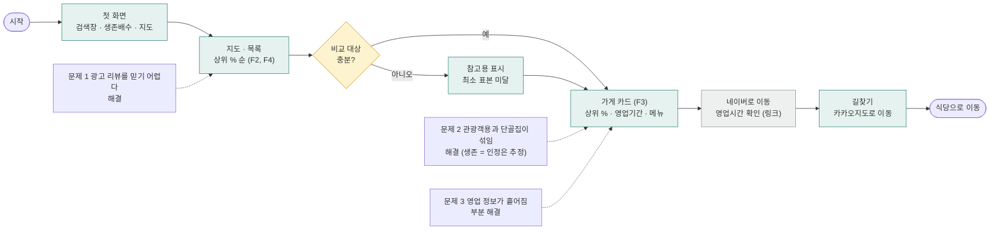

# 버틴집 유저 플로우 — 버틴집 이용 흐름과 문제 해결

> 버틴집 기획서 v1과 팀 결정만 근거로 그림. 위는 기획서 2-1의 문제 세 가지, 아래는 사용자가 거치는 화면과 갈림길 (2026-11-17)
> 고객여정지도와 설문 내용은 요청에 따라 이 문서에서 제외했습니다.

## 1. 흐름 그림

- 초록 상자 = 버틴집 화면, 회색 상자 = 버틴집 밖(네이버), 노란 마름모 = 분기, 점선 화살표 = "이 문제를 이 화면이 푼다"

### 지도 · 목록 메모

- 영업 중인 가게만 표시 (폐업 가게는 목록에서 제외, 폐업 데이터는 비교 계산에만 사용) [팀 결정]
- 검색 결과는 항상 나오도록 설정 → "결과 없음" 분기는 두지 않음 [팀 결정]
- 좌표 없는 가게(약 4%)는 목록에만 표시, 가게 카드에 "위치 정보 없음" (기획서 8-4)

### 가게 카드 메모

- 메뉴는 카드에 표시 (출처: 네이버 예정, 미확정)
- 영업시간은 네이버 링크로 이동해 확인 [팀 결정]

## 2. 기호

| 기호 | 뜻 |
|---|---|
| 둥근 상자 | 시작 · 끝 |
| 사각 상자 | 화면 · 행동 하나 (회색은 버틴집 밖) |
| 마름모 | 분기 (예 / 아니오) |
| 화살표 + 라벨 | 사용자의 행동 |

## 3. 그린 순서

1. 목표를 먼저 정함: 오래 버틴 가게를 찾아 길찾기로 이동 (기획서 8-1 흐름 A 4단계)
2. 첫 화면(검색창 · 생존배수 · 지도) → 지도 · 목록 → 가게 카드 → 길찾기 순으로 한 줄에 놓음
3. 가게 카드에서 영업시간은 네이버 링크로 이동해 확인하는 단계를 추가 (팀 결정)
4. 예외는 표본 부족(기획서 7-3, 8-3)만 분기로 둠. 검색 결과는 항상 나오고 폐업 가게는 목록에서 빠지도록 설정되어 있어 "결과 없음" · "폐업 표시" 분기는 두지 않음
5. 2-1의 문제 세 가지를 위에 놓고, 푸는 화면에 연결

## 4. 문제 → 해결 대응표

| 문제 (기획서 2-1) | 해결하는 화면 · 기능 | 정도 | 한계 |
|---|---|---|---|
| 1. 광고 리뷰를 믿기 어렵다 | 인허가 데이터로 순위를 내 광고 리뷰의 영향을 받지 않음 (2-3). 지도 · 목록을 상위 % 순으로 정렬 (F2). 광고 배너는 순위와 분리하고 MVP에서는 제외 (11-2-1, 12-1) | 해결 | 영업 기간은 "인정"의 대리 지표 (7-6) |
| 2. 관광객용 맛집과 주민 단골집이 섞여 있다 | 가게 카드에 영업기간과 "버틴집 기준 상위 N%" 표시, 지도 핀에도 배지 표시 (F3, 11-2-1). 상위 %에는 설명과 비교 기준을 함께 표시 (8-3) | 해결 (추정) | "생존 = 인정"은 추정 (3-1). 중도절단으로 영업 중 점포 배수가 높게 나올 수 있음 (3-3, R5) |
| 3. 영업 정보가 흩어져 있다 | 영업 중인 가게만 목록에 표시해 폐업 가게가 섞이지 않게 함. 가게 카드에서 영업 기간 · 메뉴를 확인하고, 영업시간은 네이버 링크로 이동해 확인 [팀 결정] | 부분 해결 | 실시간 영업 확인은 MVP 제외 (5번). 영업 상태는 월 1회 갱신이라 최근에 문 닫은 가게가 남아 있을 수 있음 (9-1) [해석]. 메뉴 출처(네이버 예정)는 미확정 |
| (예외) 표본 부족 · 좌표 없음 | "참고용" 표시 (7-3, 8-3), 목록에만 표시하고 카드에 "위치 정보 없음" (8-4) | 기획서 확정 | 최소 표본 N은 미정 (7-3) |

## 5. 확인이 필요한 부분

- 메뉴 데이터 출처: 네이버로 할 예정이나 확정은 아님. 약관 확인 필요 (기획서 6-5)
- 첫 화면의 "생존배수"가 어떤 모습으로 보이는지 (전체 요약인지, 가게별 값인지)
- 해결 정도(해결 · 부분 해결)는 기획서의 한계 항목(3-3, 10-4)을 보고 판단한 것 [해석]
- 지도에서 먼저 시작하는 흐름 B(기획서 8-1)도 같은 "지도 · 목록" 화면으로 이어진다고 보고 한 줄로 합침

## 6. 그리지 않은 것

- 고객여정지도와 설문 내용 (요청에 따라 제외)
- 업종 기준(같은 메뉴 비교): 메뉴 데이터가 확정되지 않아 2차 (기획서 12-1, 12-2)
- 즐겨찾기 · 공유(F8), 구 · 군별 대시보드(F6): 2차
- 광고 배너: MVP 제외 (기획서 12-1)
- 백년가게 검증 리포트(F7): 내부용이라 사용자 흐름이 아님
