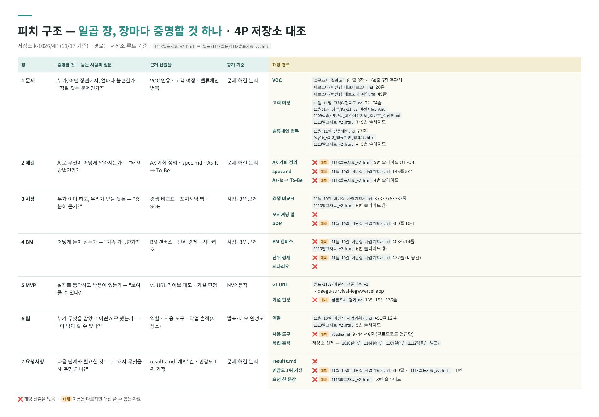

# 피치 7장 — 저장소 대조 (해당 경로 · 부족한 부분)

> 기준: Day 18 피치 구조 슬라이드(8번) "일곱 장, 장마다 증명할 것 하나"
> 대조한 저장소: `k-1026/4P` **main 브랜치** (11/17 커밋 기준). 아래 경로는 모두 main 브랜치 루트 기준입니다.
> `1113발표자료_v2.html` = `발표/1113발표/1113발표자료_v2.html` · 슬라이드 번호는 그 발표 2번 슬라이드 목차의 번호
> 표시: ❌ 해당 없음 · 🔸 이름은 다르지만 대신 쓸 수 있는 자료

---

## 1. 해당 경로

### 1장 문제 — 평가 기준: 문제-해결 논리
| 근거 산출물 | 해당 경로 |
|---|---|
| VOC 인용 | `설문조사 결과.md` 81줄 `## 3. 불편 경험과 리뷰 신뢰`, 160줄 `## 5. 주관식` · `페르소나/버틴집_대표페르소나.md` 28줄 1순위 페인 · `페르소나/버틴집_페르소나_취합.md` 49줄 |
| 고객 여정 | `11월 11일 고객여정지도.md` 22줄, 64줄 · `11월11일_첨부/Day11_v2_여정지도.html` · `1109실습/버틴집_고객여정지도_조언후_수정본.md` · `1113발표자료_v2.html` 7~9번 슬라이드 |
| 밸류체인 병목 | `11월 11일 밸류체인.md` 77줄 `## 3교시` · `Day10_v3.3_밸류체인_발표용.html` · `1113발표자료_v2.html` 4~5번 슬라이드 (B1~B3) |

### 2장 해결 — 평가 기준: 문제-해결 논리
| 근거 산출물 | 해당 경로 |
|---|---|
| AX 기회 정의 | ❌ · 🔸 `1113발표자료_v2.html` 5번 슬라이드 기회 O1~O3 |
| spec.md | ❌ · 🔸 `11월 10일 버틴집 사업기획서.md` 145줄 `## 5. 서비스 개요와 핵심 기능` (F1~F8) |
| As-Is → To-Be | ❌ · 🔸 `1113발표자료_v2.html` 4번 슬라이드 네이버 플레이스 vs 버틴집 |

### 3장 시장 — 평가 기준: 시장·BM 근거
| 근거 산출물 | 해당 경로 |
|---|---|
| 경쟁 비교표 | `11월 10일 버틴집 사업기획서.md` 373줄 10-2, 378줄 10-3, 387줄 10-4 · `1113발표자료_v2.html` 6번 슬라이드 ① 수익 구조 비교 |
| 포지셔닝 맵 | ❌ |
| SOM | ❌ · 🔸 `11월 10일 버틴집 사업기획서.md` 360줄 10-1 시장 규모 (사업체 수 기준) |

### 4장 BM — 평가 기준: 시장·BM 근거
| 근거 산출물 | 해당 경로 |
|---|---|
| BM 캔버스 | ❌ · 🔸 `11월 10일 버틴집 사업기획서.md` 403~414줄 11-1~11-2-1 · `1113발표자료_v2.html` 6번 슬라이드 ② 수익 모델 3안 |
| 단위 경제 | ❌ · 🔸 `11월 10일 버틴집 사업기획서.md` 422줄 11-3 (비용 항목만, 수익 "현재 없음") |
| 시나리오 | ❌ |

### 5장 MVP — 평가 기준: MVP 동작
| 근거 산출물 | 해당 경로 |
|---|---|
| v1 URL 라이브 데모 | `발표/1109/버틴집_생존배수_v1` → https://daegu-survival-fegw.vercel.app/ · 기능 목록 `1113발표자료_v2.html` 11번 슬라이드 |
| 가설 판정 | ❌ · 🔸 `설문조사 결과.md` 135줄 4장 가상 선택 실험, 153줄 14번 문항, 176줄 6장 |

### 6장 팀 — 평가 기준: 발표·데모 완성도
| 근거 산출물 | 해당 경로 |
|---|---|
| 역할 | `11월 10일 버틴집 사업기획서.md` 451줄 12-4 역할 분담 · `1113발표자료_v2.html` 5번 슬라이드 인적자원 |
| 사용 도구 | ❌ · 🔸 `readme.md` 9줄, 44~46줄 ("클로드코드" 언급만) |
| 작업 흔적(저장소) | 저장소 전체 — `1030실습/` `1104실습/` `1105과제/` `11월6일_실습/` `1109실습/` `1112팀플/` `발표/` |

### 7장 요청사항 — 평가 기준: 문제-해결 논리
| 근거 산출물 | 해당 경로 |
|---|---|
| results.md '계획' 칸 | ❌ (파일 없음) |
| 민감도 1위 가정 | ❌ · 🔸 `11월 10일 버틴집 사업기획서.md` 260줄, `1113발표자료_v2.html` 11번 슬라이드 (k=5·10·20 민감도 분석 계획만) |
| 요청사항 한 문장 | ❌ · 🔸 `1113발표자료_v2.html` 13번 슬라이드 "결정 필요 · 다음 할 일" |

---

## 2. 부족한 부분

### 아예 없는 산출물 (새로 만들어야 함)
| 장 | 산출물 | 메모 |
|---|---|---|
| 2 해결 | AX 기회 정의, spec.md, As-Is → To-Be | 내용은 기획서 5장과 1113 발표 4~5번 슬라이드에 흩어져 있음 → 산출물 형식으로 옮기면 됨 |
| 3 시장 | 포지셔닝 맵 | 기획서 10-3 경쟁 비교표를 두 축(예: 근거가 돈으로 바뀌는가 × 전체 점포 vs 선정 점포)으로 옮기면 됨 |
| 3 시장 | SOM | 지금은 사업체 수만 있음. 이용자 수나 금액 기준 추정이 필요함 |
| 4 BM | BM 캔버스, 시나리오 | 수익 모델 3안 중 광고 배너만 확정, 나머지 2안은 "팀 결정 전" |
| 4 BM | 단위 경제 | 수익 쪽 숫자가 없음 |
| 5 MVP | 가설 판정 | 설문 데이터는 있지만 판정 문서가 없음 |
| 6 팀 | 사용 도구 | 누가 어떤 AI를 어디에 썼는지 정리 없음 |
| 7 요청사항 | results.md, 민감도 1위 가정, 요청사항 한 문장 | 셋 다 없음. 가장 비어 있는 장 |

### 발표 전에 팀이 확인할 것
1. **설문이 핵심 가설과 반대로 나왔습니다.** `설문조사 결과.md` 14번 문항에서 "별점 4.8 · 8개월째" 50.6%, "별점 4.2 · 23년째" 32.1%. 식당 고를 때 '오래 영업한 가게'를 중요하게 본다는 응답은 2.5%뿐입니다. 다만 리뷰를 못 믿을 때 대신 보는 것으로는 16.0%가 '오래 영업한 가게'를 골랐습니다. → 5장 가설 판정, 7장 민감도 1위 가정의 재료.
2. **페르소나가 세 갈래입니다.** `페르소나/버틴집_대표페르소나.md`는 구미 33세·당일·아내 동행, `1113발표자료_v2.html`의 정하준은 수도권·1박 2일·친구, 윤미래도 따로 있음. 설문 응답자는 20대 82.7%, 대구 거주 55.6%. 1장 "누가"를 하나로 맞춰야 합니다.
3. **경쟁사 결정이 서로 다릅니다.** `11월 11일 원페이지.md`는 "경쟁사는 두지 않는다", `11월 10일 버틴집 사업기획서.md` 10-3은 경쟁 서비스 비교표가 있음.
4. **MVP URL이 지금 열리는지** 발표 전에 직접 확인이 필요합니다.
