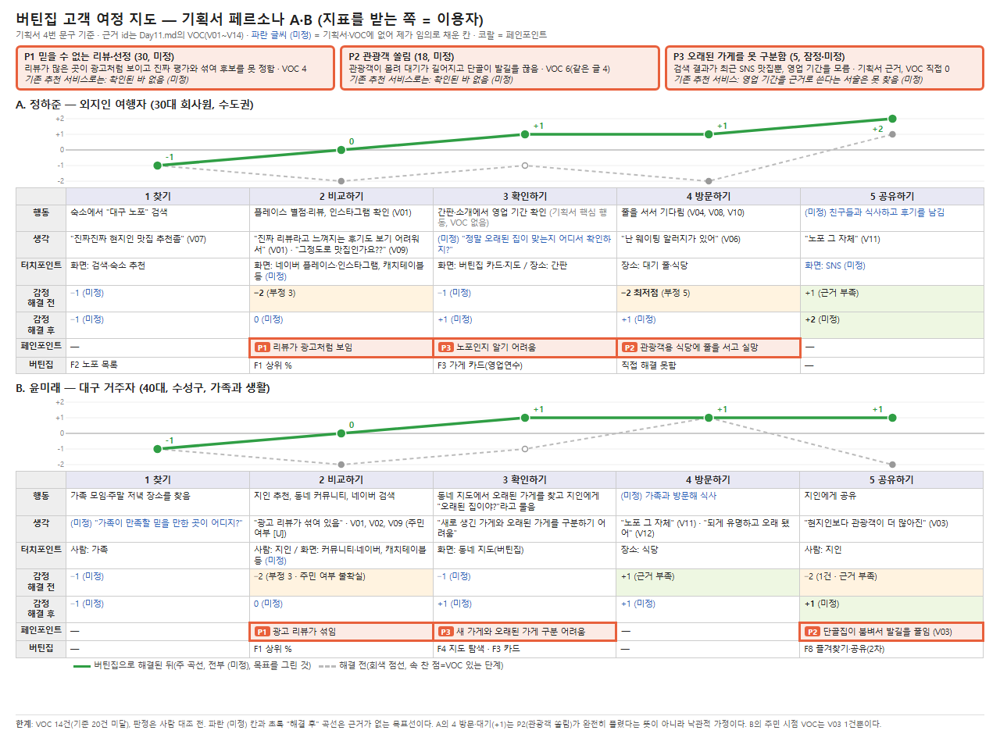

# Day 11 (v2) — 고객 여정 지도 · 페인포인트 (기획서 페르소나 2명, 지표를 받는 쪽 = 이용자)

작성일 2026-11-11 · 입력: 버틴집 기획서 2-1·4-1·4-2, `11월 11일 원페이지.md`, `11월 11일 밸류체인.md`, 실제 이용자 발언 14건
표기: [기획서] 기획서 문구 그대로 / [VOC] 실제 이용자 발언 / **(미정)** 제가 임의로 적은 것 — 확실한 정보가 아니며 확정 전 / [U] 미확인 · `V번호`는 4장 표
**확정된 것(사용자 결정)**: 버틴집은 식당을 추천하지 않고 영업 이력 **지표**를 만들어 **이용자(정하준·윤미래)에게 직접** 보여 준다.
**Local 발표 피드백(1~2교시)**: 팀 발표 피드백이 없어 해당 없음.

---

## 1. 페르소나 2명 (기획서 4번)
| 항목 | A. 정하준 — 외지인 여행자 (주 사용자) | B. 윤미래 — 대구 거주자 (보조 사용자) |
|---|---|---|
| 나이·직업 | 30대 회사원, 수도권 거주 | 40대, 대구 수성구 거주, 가족과 생활 |
| 상황 | 대구 주말 1박 2일, 친구 2명과 여행. 저녁 식사 장소를 직접 고름 | 가족 모임이나 주말 저녁 장소를 찾음. 동네 단골집을 알고 싶음 |
| 맛집 찾는 방법 | 네이버 플레이스 별점과 리뷰, 인스타그램, 숙소 추천 | 지인 추천, 동네 커뮤니티, 네이버 검색 |
| 불편함 | ① 리뷰가 많은 곳이 대부분 광고처럼 보임 ② 관광객용 식당에 줄을 서고 실망함 ③ 노포인지 아닌지 알기 어려움 | ① 새로 생긴 가게와 오래된 가게를 구분하기 어려움 ② 광고 리뷰가 섞여 있음 |
| 원하는 것 | 대구 사람들이 오래 찾는 가게. 오래 영업했다는 근거 | 동네 이웃들이 인정한 가게. 믿고 추천할 수 있는 곳 |
| 핵심 행동 | 검색 후 "노포" 키워드로 다시 찾음. 간판이나 소개에서 영업 기간을 확인함 | 동네 지도에서 오래된 가게를 찾아봄. 지인에게 "오래된 집이야?"라고 물음 |

---

## 2. 페인포인트 (핵심)
| 묶음 | A 정하준 | B 윤미래 | 기획서 문제 정의 |
|---|---|---|---|
| **P1 믿을 수 없는 리뷰·선정** | 불편함 ① | 불편함 ② | 2-1(1) |
| **P2 관광객 쏠림** | 불편함 ② | 단골집이 붐비면 떠남(V03) | 2-1(2) |
| **P3 오래된 가게를 못 구분함** | 불편함 ③ | 불편함 ① | 2-1(2) |

점수 = 빈도 × 강도 × 해결 가능성. 강도는 묶음 안 VOC의 **최댓값**으로 통일했다. 구간은 과정 기준에서 보간한 것(빈도 2점=3~5건)으로 **미정**이다.

### P1. 믿을 수 없는 리뷰·선정 — 점수 30 (미정)
**진술문**: [처음 대구에 온 여행자나 가족 모임 장소를 찾는 주민이] [식당 후보를 비교하는 단계에서] [믿을 만한 곳을 고르려다] [리뷰가 많은 곳이 광고처럼 보이고 선정·평가 문구도 믿기 어려워] 후보를 정하지 못하거나 기대와 다른 곳에 가게 된다
- **기획서 근거**: 4-1 불편함 ①, 4-2 불편함 ②, 2-1(1), 2-2
- **VOC**: V01 "진짜 리뷰라고 느껴지는 후기도 보기 어려워서", V02 "전적으로 신뢰하는 편은 아니다", V09 "그정도로 맛집인가요??", V13 "'2년 연속 블루리본 서베이 선정'이라는 문구를 보고 … 엉망이었다" — 4건, 출처 3종
- **배경**: 영수증 리뷰 건당 500~1,000원(W5), 대행 최대 건당 7,000원(W7), 신고 12만 2000건·삭제 9만 1800건(W6), 블루리본 업체 유료 등록 경로(W8)
- **점수 (미정, 제 판단)**: 빈도 2 × 강도 3(V13 이탈성 불만) × 해결 가능성 5 = **30**
- **기존 추천 서비스로는 (미정)**: 블루리본은 유료 등록 경로와 마케팅 의존 논란이 보도됐다(W8·W9). 캐치테이블이 같은 문제를 겪는지는 확인된 바 없다.
- **버틴집이 푸는 방식**: 영업 기간 지표(F1·F2·F3)를 이용자가 직접 확인
- **못 푸는 부분**: 맛·분위기. "영업 기간 = 인정"은 검증 전(기획서 3-1)

### P2. 관광객 쏠림 — 점수 18 (미정)
**진술문**: [여행자나 오래 다닌 단골이] [식당 앞에서 기다리는 단계에서] [저녁을 먹으려다] [관광객이 몰려 대기가 길어지고 현지 분위기가 사라져] 줄을 서고 실망하거나 발길을 끊는다
- **VOC**: V03~V06, V08, V10 — 6건, 출처 2종. **카페 글 4건은 같은 글**
- **점수 (미정, 제 판단)**: 빈도 3 × 강도 3 × 해결 가능성 2 = **18**
- **위험 (미정)**: 버틴집이 "오래된 가게"를 알릴수록 쏠림을 키울 수 있다. 기획서에 없는 위험이다. 지표로는 직접 해결하지 못한다.

### P3. 오래된 가게를 못 구분함 — 점수 5 (잠정, 서비스의 핵심 가정)
**진술문**: [검색으로 가게를 찾는 여행자나 주민이] ["대구 노포"를 검색하거나 동네 지도를 보는 단계에서] [오래 영업한 가게를 찾으려다] [결과가 SNS 맛집 위주이고 영업 기간을 알 수 없어] 오래된 가게와 새 가게를 구분하지 못한다
- **기획서 근거(3곳)**: 4-1 불편함 ③·시나리오, 4-2 불편함 ①, 2-1(2)
- **VOC**: 직접 발언 0건. 간접: V07 "진짜진짜 현지인 맛집 추천좀"
- **점수 (미정, 제 판단)**: 빈도 1 × 강도 1 × 해결 가능성 5 = **5** (VOC가 없어서 낮을 뿐, 서비스의 핵심 가정)
- **기존 추천 서비스로는 (미정)**: 캐치테이블의 추천 근거는 블루리본 선정·예약 연동이고 영업 기간을 근거로 쓴다는 서술은 찾지 못했다(Day09 4교시 D).

### 보류 목록
| 후보 | 이유 |
|---|---|
| 연동·예약 가능 여부 불일치 | VOC 1건(V14, 2022 블로그). 최신 여부 확인 필요 |
| 영업시간·메뉴 정보 부재 | VOC 0건, 데이터 출처 미정(기획서 6-1) |
| 인허가일≠개업일 | 고객이 느끼지 못하는 회사 내부 문제(Day10 B2) |
| 칭찬(V11, V12) | 문제가 아니라 지켜야 할 강점 |

---

## 3. 고객 여정 지도 2장
두 페르소나의 단계 이름을 **찾기 → 비교하기 → 확인하기 → 방문하기 → 공유하기**로 맞췄다(동사형). 기획서·VOC에 없는 칸은 제가 (미정)으로 채웠다. 감정 곡선은 해결되면서 올라가도록 그렸다.

### 3-1. 정하준
시나리오 [기획서 4-1]: 금요일 밤 숙소에서 "대구 노포"를 검색한다. 상위 결과는 최근 개업한 SNS 맛집뿐이다. 버틴집의 "영업 OO년, 주변 대비 X배" 표시를 보고 저녁 장소를 정한다.
| 층 | 1 찾기 | 2 비교하기 | 3 확인하기 | 4 방문하기 | 5 공유하기 |
|---|---|---|---|---|---|
| 행동 | "대구 노포" 검색 [기획서] | 별점·리뷰·인스타그램 확인 [기획서] (V01) | 간판·소개에서 영업 기간 확인 (기획서 핵심 행동, VOC 없음) | 줄을 서서 기다림 (V04, V08, V10) | (미정) 친구들과 식사하고 후기를 남김 |
| 생각 | "진짜진짜 현지인 맛집 추천좀" (V07) | "진짜 리뷰라고 느껴지는 후기도 보기 어려워서" (V01), "그정도로 맛집인가요??" (V09), "블루리본 선정 문구를 보고 갔는데 엉망이었다" (V13) | (미정) "정말 오래된 집이 맞는지 어디서 확인하지?" | "난 웨이팅 알러지가 있어" (V06) | "노포 그 자체" (V11) |
| **터치포인트** | 화면: 검색·숙소 추천 [기획서] | 화면: 네이버 플레이스·인스타그램 [기획서], 예약·큐레이션 서비스(캐치테이블 등) (미정) | 화면: 버틴집 가게 카드·지도 / 장소: 간판 | 장소: 대기 줄·식당 | 화면: SNS (미정) |
| 감정 해결 전 | −1 (미정) | −2 [VOC 4] | −1 (미정) | −2 최저점 [VOC 5] | +1 [VOC 2, 근거 부족] |
| **감정 해결 후** | −1 (미정) | 0 (미정) | +1 (미정) | +1 (미정) | **+2** (미정) |
| 페인포인트 | — | P1 | P3 | P2 | — |
| 버틴집 | F2 노포 목록 | F1 상위 % | F3 가게 카드 | 직접 해결 못함 | — |

### 3-2. 윤미래
시나리오 [기획서 4-2]: 가족 모임 장소를 고르면서 버틴집에서 동네 식당을 본다. 주변보다 훨씬 오래 버틴 식당을 발견하고 지인에게 공유한다.
| 층 | 1 찾기 | 2 비교하기 | 3 확인하기 | 4 방문하기 | 5 공유하기 |
|---|---|---|---|---|---|
| 행동 | 가족 모임·주말 저녁 장소를 찾음 [기획서] | 지인 추천·동네 커뮤니티·네이버 검색 [기획서] | 동네 지도에서 오래된 가게를 찾고 "오래된 집이야?"라고 물음 [기획서] | (미정) 가족과 방문해 식사 | 지인에게 공유 [기획서], 재방문 (V03) |
| 생각 | (미정) "가족이 만족할 믿을 만한 곳이 어디지?" | "광고 리뷰가 섞여 있음" [기획서], V01·V02·V09 (일반 소비자 발언, 주민 여부 [U]) | "새로 생긴 가게와 오래된 가게를 구분하기 어려움" [기획서] | "노포 그 자체" (V11), "되게 유명하고 오래 됐어" (V12) | "현지인보다 관광객이 더 많아진" (V03) |
| **터치포인트** | 사람: 가족 | 사람: 지인 / 화면: 동네 커뮤니티·네이버 [기획서], 예약·큐레이션 서비스(캐치테이블 등) (미정) | 화면: 동네 지도(버틴집) | 장소: 식당 | 사람: 지인 |
| 감정 해결 전 | −1 (미정) | −2 [VOC 4, 주민 여부 불확실] | −1 (미정) | +1 [VOC 2, 근거 부족] | −2 [VOC 1, 근거 부족] |
| **감정 해결 후** | −1 (미정) | 0 (미정) | +1 (미정) | +1 (미정) | **+1** (미정) |
| 페인포인트 | — | P1 | P3 | — | P2 |
| 버틴집 | — | F1 상위 % | F4 지도 탐색·F3 카드 | — | F8 즐겨찾기·공유(2차) |

### 3-3. 감정 곡선 (−2 매우 나쁨 ~ +2 매우 좋음)
- **해결 후 곡선(주)**은 전부 (미정)이다. 목표를 그린 것이지 효과의 증거가 아니다. 해결 전은 VOC가 있는 단계는 건수 기반, 없는 단계는 (미정).
- **두 페르소나 값을 다르게 했다**: 정하준은 5단계 +2(식사 만족·공유), 윤미래는 5단계 +1(단골집이 붐비는 P2가 풀리지 않아 올리지 않음).
- **풀리지 않는 곳**: 정하준 4단계(P2)의 +1은 P2가 풀렸다는 뜻이 아니라 오래된 로컬 식당이라는 낙관적 기대다. 윤미래 4단계는 해결 전에도 +1이라 개선이 없다.
- **밸류체인 병목과 대조(Day10)**: B1(추천 근거의 돈·마케팅 영향)은 "비교하기" 단계에서 고객에게도 보인다(V13). B2(인허가일≠개업일)는 고객이 못 느끼는 내부 문제다.

---

## 4. VOC — 실제 이용자 발언 14건
수집: 공개 웹, 2026-11-11, 작성자 아이디 미저장. ㉮ 한국경제 기사 속 인터뷰 · ㉯ 다음카페 글(https://m.cafe.daum.net/subdued20club/LxCT/322899) · ㉰ 블라인드 글·댓글 · ㉱ 이코노미스트 기사 속 인터뷰(W8) · ㉲ 블로그 후기(2022.4.8)
| id | 출처 | 원문 인용 | 단계 | 유형 | 강도 | 묶음 |
|---|---|---|---|---|---|---|
| V01 | ㉮ | "진짜 리뷰라고 느껴지는 후기도 보기 어려워서" | 비교 | 불만 | 2 | P1 |
| V02 | ㉮ | "전적으로 신뢰하는 편은 아니다" | 비교 | 불만 | 1 | P1 |
| V03 | ㉯ | "현지인보다 관광객이 더 많아진" | 재방문 | 불만 | 3 | P2 |
| V04 | ㉯ | "어느 순간부터 300시간 웨이팅 생겼더라" | 방문·대기 | 불만 | 2 | P2 |
| V05 | ㉯ | "서울말씨 쓰는 관광객들이 줄을 서더라고" | 방문·대기 | 불만 | 1 | P2 |
| V06 | ㉯ | "난 웨이팅 알러지가 있어" | 방문·대기 | 불만 | 1 | P2 |
| V07 | ㉰ | "진짜진짜 현지인 맛집 추천좀" | 찾기 | 요청 | 1 | P3(간접) |
| V08 | ㉰ | "웨이팅이 너무 길어요ㅠ" | 방문·대기 | 불만 | 2 | P2 |
| V09 | ㉰ | "그정도로 맛집인가요??" | 비교 | 질문 | 1 | P1 |
| V10 | ㉰ | "3시에 줄서면 8시에 먹을수있음!" | 방문·대기 | 불만 | 2 | P2 |
| V11 | ㉯ | "노포 그 자체" | 식사 | 칭찬 | 1 | 강점 |
| V12 | ㉯ | "되게 유명하고 오래 됐어" | 식사 | 칭찬 | 1 | 강점 |
| V13 | ㉱ 30대 직장인 | "'2년 연속 블루리본 서베이 선정'이라는 문구를 보고 음식점을 선택했는데 맛은 물론 위생과 서비스 등이 모두 엉망이었다" | 비교·선택 | 불만 | 3 | P1 |
| V14 | ㉲ | "종종 캐치테이블에 입점은 되어있지만, 예약을 받지 않는 곳도 있더라구요." | 예약 | 불만 | 1 | 보류 |

**한계**: 판정(단계·유형·강도·묶음)은 제가 했고 사람 대조(무작위 10건, 9건 동의)는 아직 없다. 6건이 같은 카페 글이다. V05의 "서울말씨"는 한 이용자의 표현이며 출신으로 일반화하지 않는다. VOC는 14건이라 과정 기준 20건에 못 미치고, **P3에 대한 직접 발언이 없다.** 윤미래 시점 주민 VOC는 V03 1건뿐이다.

---

## ⚠ 결정이 필요한 것 (Day 11)
1. **VOC 추가 수집**: 지금 14건, 과정 기준은 20건 이상입니다. 특히 P3(노포·영업 기간을 찾는 행동) 발언이 필요합니다.
2. **(미정) 칸과 곡선 값**: 파란 (미정) 칸과 해결 후 곡선이 팀 판단과 맞는지 확인해 주세요.
3. **VOC 판정 대조**: 무작위 10건 중 9건 동의가 합격선입니다.
4. **P2 처리**: 버틴집이 쏠림을 키울 위험을 기획서에 반영할지 정해 주세요.

---

## 부록 — 여정 지도 (HTML 캡처)

원본 HTML: [Day11_v2_여정지도.html](11월11일_첨부/Day11_v2_여정지도.html)
