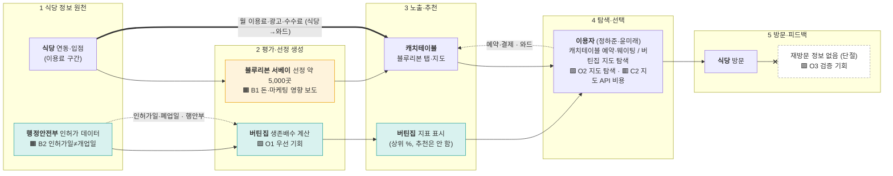
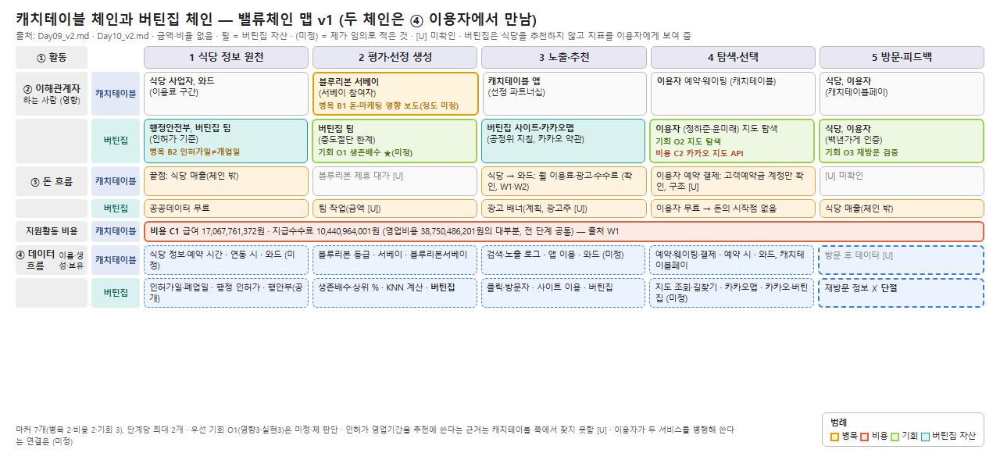

# Day 10 (v2) — 밸류체인 맵: 음식점 추천 체인 비교 (캐치테이블 vs 버틴집)

작성일 2026-11-11 · 입력: `11월 11일 원페이지.md`(W1~W7, P) · 이름은 입력 자료에 나온 것만 · 금액·비율은 원문 값만(계산값은 "계산값"으로 표시)
표기: [F] 원문 사실 / **(미정)** 제가 임의로 적은 것 — 확실한 정보가 아님 / [U] 미확인 / ⚠결정
**구조**: 같은 5단계 위에 **캐치테이블 체인(위)**과 **버틴집 체인(아래)**을 나란히 놓고 단계마다 비교한다. 블루리본서베이는 캐치테이블의 파트너로 ② 단계에 표시한다. 다른 서비스는 체인에 넣지 않는다(Day 9 결정: 경쟁사 없음).
**팀 자산(틸)** = 대구 일반음식점 인허가 데이터와 생존배수(P).
**확정된 것(사용자 결정)**: 버틴집은 식당을 추천하지 않고 영업 이력 **지표**를 만들어 **이용자에게 직접** 보여 준다. 두 체인은 ④ 단계의 **이용자**에서 만난다(이용자가 캐치테이블로 예약하고 버틴집으로 영업 이력을 확인하는 병행 사용은 (미정)).

---

## 1교시 — 활동 발산

### 주활동 5단계 (두 체인 공통 이름)
| 단계 | 캐치테이블 체인 | 버틴집 체인 |
|---|---|---|
| ① 식당 정보 원천 | 식당이 이용료를 내고 연동·입점 [F, W2 이용료 구간] | 행정안전부 일반음식점 인허가 데이터 수집 [F, P 6-1] |
| ② 평가·선정 생성 | 블루리본서베이가 선정한 식당 약 5,000곳 [F, W3]. 이용자 리뷰는 서술 없음 [U] | 영업기간·주변 폐업 점포로 생존배수 계산 [F, P 3-2] |
| ③ 노출·추천 | 앱 메인 블루리본 탭과 지도 [F, W3] | "버틴집 기준 상위 N%" **지표**를 지도·가게 카드에 표시. 식당을 추천하지는 않음(사용자 결정) [F, P 8-2] |
| ④ 탐색·선택 | 예약·웨이팅. 연동 매장만 가능 [F, W3] | 지도에서 오래 버틴 가게 탐색, 길찾기. 예약 없음 [F, P] |
| ⑤ 방문·피드백 | 방문 후 데이터 서술 없음 [U] | 재방문 정보가 돌아오지 않음 [F, P 3-3의 7번] |

블루리본서베이: ② 단계의 선정 주체이자 캐치테이블의 공식 파트너(W3).

### 지원활동 4층
| 층 | 캐치테이블 | 버틴집 |
|---|---|---|
| 기업 인프라 | 결제 자회사 캐치테이블페이 100% 출자 [F, W1:1036] | 팀 4명 역할 분담 [F, P 12-4] |
| 인적자원 | 급여 17,067,761,372원 [F, W1:404] | 팀원(비용 없음 (미정)) |
| 기술개발 | 시스템 소프트웨어 개발·공급업 [F, W1:953] | Python·KNN 계산 [F, P 9-3] |
| 조달 | 블루리본서베이 공식 파트너 계약 [F, W3] | 행안부 공공데이터(무료), 카카오 API [F, P 6-1] |

## 2교시 — 단계 5개 · 이해관계자 · 네 층

### 이해관계자 (하는 사람 / 영향 주는 사람)
| 단계 | 캐치테이블 체인 | 버틴집 체인 |
|---|---|---|
| ① | **식당 사업자**, **와드(캐치테이블)** (영향: 이용료 구간) | **행정안전부**, **버틴집 팀** (영향: 인허가 기준) |
| ② | **블루리본 서베이** (영향: 서베이 참여자) | **버틴집 팀** (영향: 중도절단·시기 차이 한계, P 3-3) |
| ③ | **캐치테이블 앱** (영향: 선정 파트너십) | **버틴집 사이트·카카오맵** (영향: 카카오 약관, 공정위 표시·광고 지침, P 6-5) |
| ④ | **이용자**, **식당** | **이용자(정하준·윤미래)** (영향: 광고·체험단 글, P 2-1) |
| ⑤ | **식당**, **이용자** (영향: 캐치테이블페이 결제) | **식당**, **이용자** (영향: 백년가게 인증, P 10-2) |

여섯 유형 중 원천·플랫폼·소비자·파트너(결제)·공공(행안부·공정위) 5유형을 채웠다. "제조·제작"은 식당 추천 체인에 해당이 약해 비웠다 (미정).
블루리본은 ②에서 평가 주체로 해당 칸에 둔다.

### ③ 돈 흐름 (이용자·식당 → 원천)
| | 캐치테이블 | 버틴집 |
|---|---|---|
| 시작점 | 확인된 주 수익은 **식당이 내는 월 이용료**(W2)와 서비스매출(W1:389). 이용자 예약 결제는 "고객예약금" 계정 19,337,455원만 확인, 구조는 [U] | 이용자는 **무료 이용** [F, P 11-1] |
| 차감 | 식당 → 와드 월 이용료(150건 미만 3만3000원~450건 이상 9만9000원, 2024 기사), 광고·수수료 [F, W2] | 없음 |
| 부수 | 블루리본 제휴 광고·수수료 (미정) | 광고 배너(계획, 광고주 [U]) [F, P 11-2] |
| 끝점 | 식당 매출(체인 밖) | 식당 방문 매출(체인 밖) |
| 주요 비용 | 영업비용 38,750,486,201원 중 급여 약 44%, 지급수수료 약 27% [F 원문, %는 계산값, W1] | 호스팅·API·갱신 작업(금액 [U]) [P 11-3] |

### ④ 데이터 흐름 — 15칸 (5단계 × 데이터 이름 · 생성 지점 · 보유자)
**캐치테이블**
| 단계 | 데이터 이름 | 생성 지점 | 보유자 | 근거 |
|---|---|---|---|---|
| ① | 식당 정보·예약 가능 시간 | 식당이 연동할 때 | 와드 (미정) | W2 |
| ② | 블루리본 등급 | 서베이 | 블루리본서베이 | W3 |
| ③ | 검색·노출 로그 | 앱 이용 | 와드 (미정) | — |
| ④ | 예약·웨이팅·결제 | 예약 시점, 캐치테이블페이 | 와드, 캐치테이블페이 | W1 |
| ⑤ | 방문 후 데이터 | [U] | [U] | — |

**버틴집**
| 단계 | 데이터 이름 | 생성 지점 | 보유자 | 근거 |
|---|---|---|---|---|
| ① | 인허가일·폐업일·영업상태 | 행정 인허가 | 행정안전부(공개) | P 6-1 [F] |
| ② | 생존배수·상위 % | 계산(KNN k=10) | **버틴집** | P 3-2 [F] |
| ③ | 클릭·방문자 | 사이트 이용 | 버틴집 | P 14-1 [F] |
| ④ | 지도 조회·길찾기 | 카카오맵 | 카카오·버틴집 | P 9-3 (미정) |
| ⑤ | 재방문 | — | **없음(단절)** | P 3-3 [F] |

**피드백**: 캐치테이블은 ④ 예약 결과가 ②·③으로 돌아가는지 서술이 없다 [U]. 버틴집은 ⑤→② 피드백이 없다.
**단절**: 인허가 영업기간이 추천에 쓰인다는 근거는 두 체인 어디에도 없다(캐치테이블: Day09 Q10 ❌) [U].

## 3교시 — 신호 · 마커 · 우선 기회

### 신호 근거
| 신호 | 단계 | 근거 | 출처 | 짝이 되는 AI 기회 |
|---|---|---|---|---|
| 추천 근거의 돈·마케팅 영향 | ② | 블루리본 등재 4경로 중 업체 직접 등록은 유료(이코노미스트), 발행사 연매출 15억 안팎·대기업 제휴 리본·온라인 투표 취약성 지적(한국경제) | W8, W9 | 영업 이력 같은 비광고 근거 |
| 연동≠예약 가능 | ④ | 캐치테이블에 입점돼 있어도 예약을 받지 않는 곳이 있다는 이용자 발언(2022 블로그), 선정 식당 전체가 예약을 지원하는 것은 아님(W3) | W3, VOC V14 | 정보 정확도 |
| 품질 편차(리뷰) | 참고 | 영수증 리뷰 건당 500~1,000원 / 대행 최대 건당 7,000원 / 신고 12만 2000건 — **네이버 플레이스 등 리뷰 기반 추천의 사례**. 캐치테이블에 리뷰가 있다는 서술은 없어([U]) 마커로 쓰지 않음 | W5, W6, W7 | 대체 신호(영업기간) |
| 중간 차감 | 지원활동(전 단계 공통) | 급여 약 44%·지급수수료 약 27%(영업비용, 계산값), 영업손실 지속 | W1 | — |
| 중간 차감 | ④ | 카카오 API 비용·호출 한도(외부 공개 시, 단가는 [U]) | P R8, 11-3 | — |
| 정보 정확도 | ① | 인허가일 ≠ 실제 개업일 가능성 | P 3-3의 2번 | 데이터 정제 |
| 데이터 단절 | ⑤ | 재방문 정보가 돌아오지 않음 | P 3-3의 7번 | 검증 |
| 대기·지연 | — | 근거 없음 → 마커 안 만듦 | — | — |

### 마커 7개 (병목 2 · 비용 2 · 기회 3)
| ID | 종류 | 단계 | 대상 | 내용 | 근거 |
|---|---|---|---|---|---|
| B1 | 병목 | ② | 블루리본(캐치테이블 파트너) | 추천 근거(선정·투표)가 돈·마케팅의 영향을 받을 수 있다는 지적 | W8, W9 [F, 보도] — 영향의 크기는 **미정** |
| B2 | 병목 | ① | 버틴집 | 인허가일 ≠ 실제 개업일 가능성 | P 3-3 [F] |
| C1 | 비용 | 지원활동(전 단계 공통) | 캐치테이블 | 급여·지급수수료가 영업비용 대부분, 영업손실 8,632,245,310원 | W1 [F] |
| C2 | 비용 | ④ | 버틴집 | 카카오 지도 API 호출 비용(외부 공개 시, 단가 [U]) | P R8, 11-3 [F, 계획] |
| O1 | 기회 | ② | 버틴집 | 영업 기간 기반 생존배수·"버틴집 기준 상위 N%" 지표 | P 3-2, 7-4 |
| O2 | 기회 | ④ | 버틴집 | 지도에서 오래 버틴 가게 탐색 (캐치테이블도 블루리본 지도 신설, W3 → 경쟁 지점) | P F4, W3 |
| O3 | 기회 | ⑤ | 버틴집 | 재방문 데이터로 "생존=인정" 가정 검증 | P 3-3 |

단계별 마커: ① B2 · ② B1, O1 · ③ 없음 · ④ C2, O2 · ⑤ O3 (단계당 최대 2개 준수). C1은 특정 단계가 아니라 지원활동 층에 붙인다.

### 우선 기회 매트릭스 (영향·실현 가능성 각 1~3 — **미정, 제 판단**)
| 기회 | 영향 | 실현 가능성 | 합 | 사분면 |
|---|---|---|---|---|
| O1 생존배수 | 3 (비광고 근거) | 3 (CSV 보유, Python) | 6 | **먼저 간다** |
| O2 지도 탐색 | 2 (캐치테이블도 지도 신설) | 2 (카카오 API 키 필요) | 4 | 빠른 성과 |
| O3 재방문 검증 | 3 | 1 (데이터 없음) | 4 | 보류 |

**우선 기회: O1 (미정).** 중도절단 한계(P 3-3 1번)를 화면에 함께 표시한다.

## 4교시 — 검증 → v1

### 초안이 자주 틀리는 6자리 점검
| 점검 | 결과 |
|---|---|
| 일반론 단계 | 단계 이름을 "정보 원천 → 선정 → 노출 → 탐색·선택 → 방문"으로 두 체인에 같게 맞췄다. 캐치테이블 ⑤는 근거 없음 [U] |
| 이름 없는 상자 | 블루리본·와드·캐치테이블페이는 실명. 리뷰 대행업체의 세부는 [U] |
| 단계 누락·과잉 | 캐치테이블의 "식당 연동" 이전 단계(영업 활동 등)는 근거가 없어 넣지 않음 |
| 수치 환각 | 맵에는 금액·비율 없음. 본문 숫자는 W1 원문 값, %는 (미정) |
| 지역 맥락 | 대구 인허가 데이터를 틸로 표시 |
| 마커 남발 | 7개, 단계당 최대 2개, 근거 없는 신호 제외 |

### 불일치 · 결정
| 항목 | 문제 | 임시 결정 |
|---|---|---|
| 돈 시작점 | 캐치테이블의 확인된 돈은 식당 → 와드 이용료, 버틴집은 이용자 무료라 시작점이 다름 | 두 체인 돈 칸을 따로 표시, 이용자 결제는 [U] |
| 캐치테이블 ⑤ | 방문 후 데이터 서술 없음 | [U]로 둠 |

### 이 단계의 한계
- 캐치테이블 체인은 감사보고서(숫자)와 기사 2건으로 만들어 서비스 내부 업무는 (미정)·[U]가 많다.
- v0 초안·프롬프트 기록은 남기지 않았다(v1만). 검증은 위 표뿐이다.
- 이용자가 두 서비스를 병행해 쓴다는 연결(④)은 (미정)이다. 확인된 자료에 근거가 없다.

## ⚠ 결정이 필요한 것 (Day 10)
1. **우선 기회 매트릭스 점수**(O1 6점, O2 4점, O3 4점)는 제 판단입니다. 팀 점수로 바꿔 주세요.
2. **O2(지도 탐색)**: 캐치테이블도 블루리본 지도를 신설했습니다. 버틴집 MVP에서 지도를 차별점으로 둘지, 보조로 둘지 정해 주세요.
3. **돈 흐름 방향**: 버틴집은 이용자 무료·광고 배너 수익(광고주 이름 없음)입니다. 광고주를 누구로 상정할지 정해 주세요.

---

## 부록 1 — Mermaid 다이어그램 (v1) · `-->` 활동 · `==>` 돈 · `-.->` 데이터 · 틸 = 버틴집 자산

범례: 🟧 병목 · 🟥 비용 · 🟩 기회 · 틸 = 버틴집 자산. 🟥 C1(캐치테이블 급여·지급수수료)은 특정 단계가 아니라 지원활동 전반이라 그림에 넣지 않았다. 버틴집 광고 배너 수익은 계획이고 광고주가 없어 [U]라 화살표로 넣지 않았다. 캐치테이블의 방문 후 피드백은 서술이 없어 그리지 않았다. 점선(-.->)은 실제 확인된 흐름만 그렸다.

## 부록 2 — 밸류체인 맵 v1 (네 층, 두 체인 비교)

원본 HTML: [Day10_v2_밸류체인.html](11월11일_첨부/Day10_v2_밸류체인.html)
