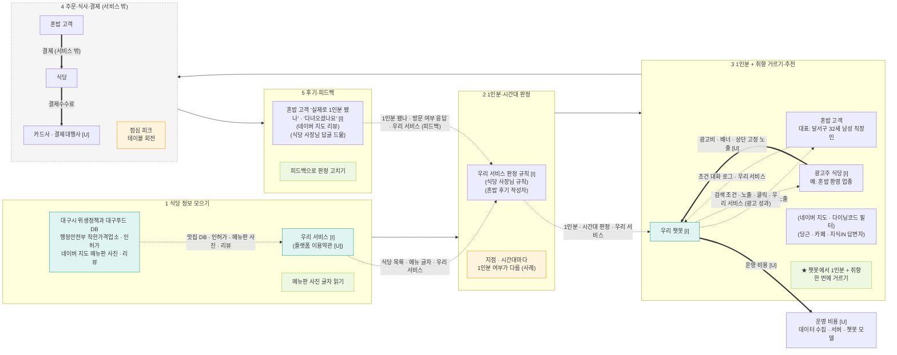

# 밸류체인 맵 v1 — 혼밥 챗봇 서비스 체인

- 작성일: 2026-11-23
- v0에서 바꾼 것: `analysis.md` 검증 SV1~SV13 (팀이 제안대로 모두 반영)
- 단계: 1 식당 정보 모으기 → 2 1인분·시간대 판정 → 3 1인분 + 취향 거르기·추천 → 4 주문·식사·결제 (서비스 밖) → 5 후기·피드백
- 산업 체인과의 연결 (SV1): 1 · 2단계는 고객에게 보이지 않는 내부 작업이다.
  산업 체인 v1의 2단계 "정보 올리기"에서 나온 메뉴판 사진 · 공공 DB를 받아, 3단계 "찾기·알아보기·고르기"에 판정 결과를 내놓는다.
- 광고 예산 경쟁 (SV5): 광고주 식당은 같은 광고 예산을 지도 앱 광고비(산업 체인 v1, [U])와 나눈다 [I].
- 화살표: 정보 흐름 `-->`, 돈 흐름 `==>`, 데이터 흐름 `-.->` (라벨: 데이터 이름 · 보유자)
- 색: 병목 주황, 비용 코랄(근거 없어 0개, SV10), 기회 라임, 팀 자산 틸, 서비스 밖 단계는 회색 점선 상자
- 영향 주는 사람은 (괄호)로 적었다.
- 숫자는 쓰지 않았다.

## 단계별 근거

| 단계 | 이해관계자 | 돈 | 데이터 (이름 · 보유자 · 피드백) | 마커 | 근거 |
|---|---|---|---|---|---|
| 1 식당 정보 모으기 | 우리 서비스, 대구시 위생정책과, 행정안전부, 네이버 지도, (식당 사장님) | 우리 서비스 → 운영 비용 [U] (데이터 수집) | 맛집 DB · 대구시, 인허가 · 착한가격업소 · 행정안전부, 메뉴판 사진 · 리뷰 · 네이버 | 기회: 메뉴판 사진 글자 읽기 | [출처 10], [출처 14], [출처 15], [출처 25], [출처 35] |
| 2 1인분·시간대 판정 | 우리 서비스, (식당 사장님), (혼밥 후기 작성자) | 우리 서비스 → 운영 비용 [U] (판정 · 모델) | 1인분 · 시간대 판정 · 우리 서비스. 5단계 피드백을 받음 | 병목: 지점 · 시간대마다 다름 (사례) | [출처 30], [출처 34] |
| 3 1인분 + 취향 거르기·추천 | 혼밥 고객, 우리 챗봇, 광고주 식당 (예: 혼밥 환영 업종 [출처 36]), (지도 앱 필터), (커뮤니티 답변자) | 광고주 식당 → 우리 서비스: 광고비 [U] (돈의 시작점) | 조건 대화 로그 · 추천 결과 · 광고 노출 · 클릭, 모두 우리 서비스 보유 | 기회: ★ 챗봇에서 한 번에 거르기 (우선 기회 O2) | [출처 16], [출처 26], [출처 31], R1 |
| 4 주문·식사·결제 | 혼밥 고객, 식당, 카드사 · 결제대행사 [U] | 고객 → 식당: 결제, 식당 → 카드사: 결제수수료 (서비스 밖) | 서비스에 안 들어옴. 5단계 "다녀오셨나요?" 질문으로 대신한다 (SV13) [I] | 병목: 점심 피크 테이블 회전 | [출처 36] |
| 5 후기·피드백 | 혼밥 고객, (네이버 지도 리뷰), (식당 사장님) | 없음 | "1인분 됐나" · 방문 여부 응답 · 우리 서비스 → 2단계 (피드백) | 기회: 피드백으로 판정 고치기 | [출처 25], [출처 35] |

- 돈의 시작점: 3단계 광고비 [U].
  끝점: 운영 비용 [U].
  고객 결제는 서비스 밖이다.
- 결정 항목 (SV12): 상단 고정 노출 가게가 1인분 불가로 판정되면 Top 1 불편이 서비스 안에서 다시 생긴다 [I].
  "1인분 가능으로 판정된 가게만 광고 노출" 규칙을 서비스 기획에서 정한다.
- 다른 수익 경로(B2G · B2B 리포트)는 `../analysis.md` 서비스 매핑 절의 결정 뒤에 넣는다 (SV6).

## 근거 없이 남은 항목

- 우리 서비스의 활동 전부 [I]
- 광고비 금액 · 광고주가 생길지 [U]
- 운영 비용 금액 [U]
- 메뉴판 사진 수집 가능 여부 (이용약관) [U]
- 비용 마커 근거 (0개) [U]
