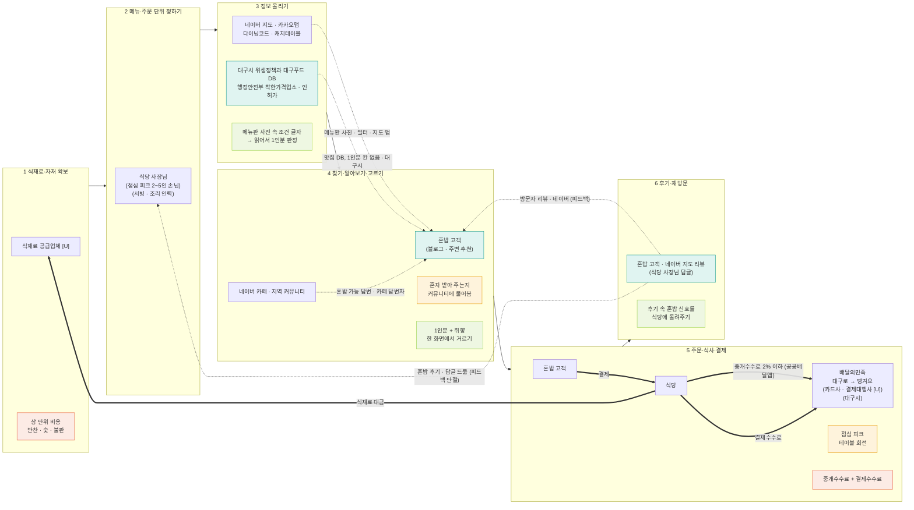

# 밸류체인 맵 v0 — 대구 외식 · 혼밥 산업 체인

- 작성일: 2026-11-23 (A4 초안, A5 검증 전)
- 입력: `stakeholders.md`, `signals.md`, `R1_원페이지.md`, `sources.md`
- 단계: 1 식재료·자재 확보 → 2 메뉴·주문 단위 정하기 → 3 정보 올리기 → 4 찾기·알아보기·고르기 → 5 주문·식사·결제 → 6 후기·재방문
- 화살표: 상품·정보 흐름 `-->`, 돈 흐름 `==>` (고객 → 원천 방향), 데이터 흐름 `-.->` (라벨: 데이터 이름 · 보유자)
- 색: 병목 주황, 비용 코랄, 기회 라임, 팀 자산 틸
- 숫자는 [출처]가 있는 것만 넣었다.
  라벨 안 숫자는 중개수수료 상한 2% 하나뿐이다 [출처 18].

## 단계별 근거

| 단계 | 이해관계자 | 돈 | 데이터 (이름 · 보유자 · 피드백) | 마커 | 근거 |
|---|---|---|---|---|---|
| 1 식재료·자재 확보 | 식재료 공급업체 [U], 식당 | 식당 → 공급업체: 식재료 대금 [I] | 없음 [U] | 비용: 상 단위 비용 (signals C1) | stakeholders 1단계, [출처 33], [출처 36] |
| 2 메뉴·주문 단위 정하기 | 식당 사장님, (점심 피크 손님), (인력) | 없음 | 주문 단위 · 시간대 규칙 · 식당 보유. 후기 피드백이 돌아오지 않음 | — (G6 기회 후보는 맵에서 뺌, 단계 4·6 기회와 겹침) | [출처 34], [출처 12], [출처 35] |
| 3 정보 올리기 | 지도 앱 4곳, 대구시 위생정책과, 행정안전부, 식당 사장님 | 없음 [U] (지도 앱 광고비 자료 없음) | 메뉴판 사진 · 플랫폼 보유, 맛집 DB · 대구시 보유 (1인분 칸 없음) | 기회: 메뉴판 사진 글자 읽기 (G1) | [출처 10], [출처 11], [출처 16], [출처 35] |
| 4 찾기·알아보기·고르기 | 혼밥 고객, 지도 앱, 커뮤니티 답변자 | 없음 | 필터 결과 · 지도 앱 보유, 혼밥 가능 답변 · 카페 보유, 리뷰 · 네이버 보유 (피드백) | 병목: 커뮤니티에 물어봄 (G4). 기회: 1인분 + 취향 한 화면 거르기 (G3) | [출처 6], [출처 16], [출처 30], [출처 31] |
| 5 주문·식사·결제 | 혼밥 고객, 식당, 배달의민족, 대구로 → 땡겨요, (카드사 [U]), (대구시) | 고객 → 식당: 결제. 식당 → 플랫폼: 중개수수료 (공공배달앱 차기 조건 2% 이하) · 결제수수료 | 주문 내역 · 배달 플랫폼 보유 [I] | 병목: 점심 피크 테이블 회전 (G8). 비용: 수수료 중첩 (G9) | [출처 7], [출처 17], [출처 18], [출처 19], [출처 36] |
| 6 후기·재방문 | 혼밥 고객, 네이버 지도, (식당 사장님 답글) | 없음 | 방문자 리뷰 · 네이버 보유 → 4단계 고객에게 (피드백), → 2단계 식당에는 거의 안 돌아감 | 기회: 후기 속 혼밥 신호를 식당에 돌려주기 (G10) | [출처 25], [출처 30], [출처 35] |

## 마커 고른 이유

| 종류 | 고른 것 | 뺀 것 |
|---|---|---|
| 병목 2 | G4 커뮤니티에 물어봄 (고객 글 Top 1), G8 점심 피크 테이블 회전 (사장님이 꺼리는 이유 1위) | G2 공공 DB 칸 없음, G5 지점마다 다름 → G3 · G4와 같은 뿌리라 합침 [I] |
| 비용 2 | G9 수수료 중첩, C1 상 단위 비용 | C2 식재료비 · 인건비 (배경이라 뺌) |
| 기회 3 | G1 메뉴판 사진 글자 읽기, G3 한 화면 거르기, G10 후기 신호 돌려주기 | G6 시간대별 1인분 표시 (G1 · G3에 포함 가능 [I]), G7 (근거 1건) |

## 근거 없이 남은 항목

- 식재료 대금 흐름 [I], 공급업체 실명 [U]
- 지도 앱 광고비 · 민간 배달앱 수수료 [U]
- 결제수수료 숫자 (대구로 2.2%는 C 기사라 맵에 쓰지 않음)
- 5단계 주문 내역 데이터 보유자 [I]
- C1 비용 마커는 킷 여섯 신호 밖의 근거다 (A5에서 점검)
