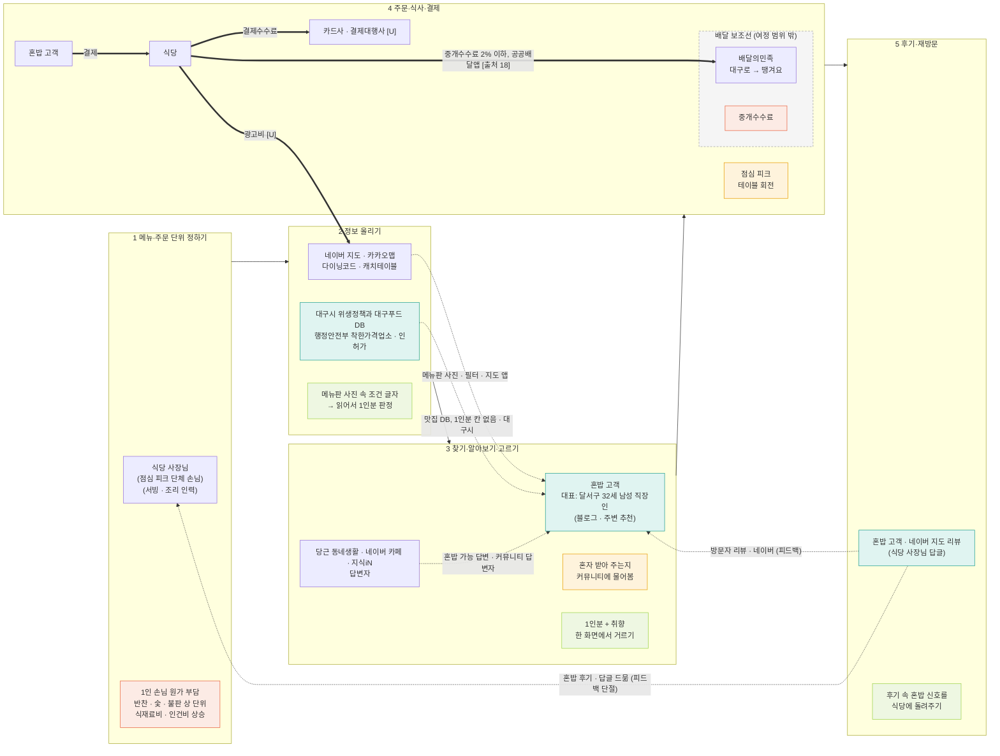

# 밸류체인 맵 v1 — 대구 외식 · 혼밥 산업 체인

- 작성일: 2026-11-23
- v0에서 바꾼 것: `analysis.md` '검증' 절의 팀 결정 (반영 10 · 반영(변형) 2 · 보류 3 · 반박 1)
- 단계 (V1 반영으로 6 → 5단계): 1 메뉴·주문 단위 정하기 → 2 정보 올리기 → 3 찾기·알아보기·고르기 → 4 주문·식사·결제 → 5 후기·재방문
- 화살표: 상품·정보 흐름 `-->`, 돈 흐름 `==>` (고객 → 원천 방향), 데이터 흐름 `-.->` (라벨: 데이터 이름 · 보유자)
- 색: 병목 주황, 비용 코랄, 기회 라임, 팀 자산 틸, 배달 보조선은 회색 점선 상자
- 하는 사람과 영향 주는 사람: 영향 주는 사람은 (괄호)로 적는다.
  굵은 글씨(`<b>`)는 미리보기에서 태그가 글자로 보여 뺐다(2026-11-23).
- 배달 · 포장은 고객여정지도 범위 밖이라 보조선으로만 남겼다 (V7).
- 숫자는 [출처]가 있는 것만 넣었다.
  라벨 안 숫자는 중개수수료 상한 2% 하나뿐이다 [출처 18].

## 단계별 근거

| 단계 | 이해관계자 | 돈 | 데이터 (이름 · 보유자 · 피드백) | 마커 | 근거 |
|---|---|---|---|---|---|
| 1 메뉴·주문 단위 정하기 | 식당 사장님, (점심 피크 단체 손님), (서빙 · 조리 인력) | 없음 (식재료 대금은 V1로 맵에서 뺌) | 주문 단위 · 시간대 규칙 · 식당 보유. 후기 피드백이 거의 돌아오지 않음 | 비용: 1인 손님 원가 부담 | [출처 12], [출처 33], [출처 34], [출처 36] |
| 2 정보 올리기 | 지도 앱 4곳, 대구시 위생정책과, 행정안전부, 식당 사장님 | 식당 → 지도 앱: 광고비 [U] | 메뉴판 사진 · 플랫폼 보유, 맛집 DB · 대구시 보유 (1인분 칸 없음) | 기회: 메뉴판 사진 글자 읽기 | [출처 10], [출처 11], [출처 16], [출처 35] |
| 3 찾기·알아보기·고르기 | 혼밥 고객(대표 페르소나), 지도 앱, 당근 동네생활 · 네이버 카페 · 지식iN 답변자 | 없음 | 필터 결과 · 지도 앱 보유, 혼밥 가능 답변 · 커뮤니티 보유, 리뷰 · 네이버 보유 (피드백) | 병목: 커뮤니티에 물어봄. 기회: 1인분 + 취향 한 화면 거르기 | [출처 6], [출처 16], [출처 27], [출처 30], [출처 31] |
| 4 주문·식사·결제 | 혼밥 고객, 식당, 카드사 · 결제대행사 [U], (보조선) 배달의민족 · 대구로 → 땡겨요 | 고객 → 식당: 결제. 식당 → 카드사: 결제수수료. (보조선) 식당 → 배달 플랫폼: 중개수수료, 공공배달앱 차기 조건 2% 이하 | 주문 내역 · 플랫폼 보유 [I] | 병목: 점심 피크 테이블 회전. 비용: 중개수수료 (여정 범위 밖) | [출처 7], [출처 17], [출처 18], [출처 19], [출처 36] |
| 5 후기·재방문 | 혼밥 고객, 네이버 지도, (식당 사장님 답글) | 없음 | 방문자 리뷰 · 네이버 보유 → 3단계 고객에게 (피드백), → 1단계 식당에는 거의 안 돌아감 | 기회: 후기 속 혼밥 신호를 식당에 돌려주기 | [출처 25], [출처 30], [출처 35] |

- 돈의 시작점: 4단계 고객 결제.
  끝점: 식당(매출), 카드사(결제수수료), 지도 앱(광고비 [U]), 배달 플랫폼(중개수수료, 보조선).
- 우리 서비스가 정한 수익(광고 배너 · 검색창 상단 고정 노출, R1 2026-11-23 결정)은 2단계 "식당 → 지도 앱: 광고비"와 같은 자리를 두고 경쟁한다 [I].
  서비스 체인과 A8에서 다룬다.

## 마커 요약

| 종류 | 마커 | 단계 | 신호 |
|---|---|---|---|
| 병목 | 혼자 받아 주는지 커뮤니티에 물어봄 | 3 | G4 한 사람 의존 |
| 병목 | 점심 피크 테이블 회전 | 4 | G8 대기·지연 |
| 비용 | 1인 손님 원가 부담 | 1 | C1 + C2 (여섯 신호 밖, V12) |
| 비용 | 중개수수료 (배달 보조선) | 4 | G9 중간 차감 중첩 |
| 기회 | 메뉴판 사진 글자 읽기 | 2 | G1 정보 재입력 |
| 기회 | 1인분 + 취향 한 화면 거르기 | 3 | G3 데이터 단절 |
| 기회 | 후기 속 혼밥 신호를 식당에 돌려주기 | 5 | G10 데이터 단절 |

## 근거 없이 남은 항목

- 지도 앱 광고비 금액 · 구조 [U]
- 카드사 · 결제대행사 실명과 수수료 [U]
- 4단계 주문 내역 데이터 보유자 [I]
- 배달비 (보조선 안, 자료 없음) [U]
