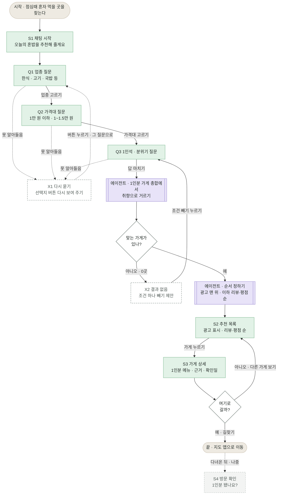

# 혼밥 에이전트 유저 플로우 (userflow.md) — v2 채팅형

- 작성일: 2026-11-23 (v1 한 문장 입력형 → v2 채팅 질문형으로 바꿈, 팀 결정)
- 기준: Day14 3교시 — 화면은 사각형, 분기는 마름모, 화살표에 사용자 행동, 주 경로 1개 + 예외 경로 2개 이상
- 재료: `혼밥_페르소나_확정안_20261120.md`, `혼밥_문제정의_단계별정리_최종본_20261120.md`, `journey_map.md`

## 주인공과 상황

> 점심때, 대구 달서구에 혼자 사는 32세 직장인 남성이 혼자 먹을 식당을 찾는다.
> **기대:** 1인분이 되는 집 중에서 내 취향에 맞는 곳을 한 번에 추천받고 싶다.

- **목표 화면(끝):** 갈 가게를 정하고 지도 앱으로 넘어간다.

## 서비스 동작 (팀 결정)

1. 처음 들어오면 채팅창이 뜨고 "오늘의 혼밥을 추천해 줄게요"로 시작한다.
2. 질문 순서: **업종 → 가격대 → 1인석 여부·분위기**. 질문마다 선택지 버튼과 "상관없어요" 버튼을 둔다.
3. 에이전트는 **1인분이 되는 가게 전체**(근거 확정·추정)를 모아 두고, 답한 취향으로 거른다.
4. 추천 순서: **리뷰·평점이 높은 순**. 단, **광고 가게는 맨 위**에 두고 이름 옆에 **[광고]** 표시를 붙인다.

## 화면 목록

| id | 화면 | 보이는 것 |
|---|---|---|
| S1 | 채팅 시작 | "오늘의 혼밥을 추천해 줄게요" 인사 |
| Q1 | 업종 질문 | 한식·고기·국밥 등 버튼, 상관없어요 |
| Q2 | 가격대 질문 | 1만 원 이하 · 1~1.5만 원 · 상관없어요 |
| Q3 | 1인석·분위기 질문 | 1인석 필요/상관없음, 조용한·빠른 한 끼 등 |
| S2 | 추천 목록 | [광고] 가게 맨 위, 이하 리뷰·평점 높은 순 |
| S3 | 가게 상세 | 1인분 메뉴·가격, 근거 출처·확인일, 길찾기 |
| S4 | 방문 확인 (나중) | "1인분 됐나요?" |
| X1 | 다시 묻기 (예외) | 답을 못 알아들으면 선택지 버튼으로 다시 질문 |
| X2 | 결과 없음 (예외) | "1인석 조건을 빼고 볼까요?"처럼 조건 하나 빼기 제안 |

## 유저 플로우 (Mermaid)

### 읽는 법

| 기호 | 뜻 |
|---|---|
| 둥근 상자 | 시작 · 끝 |
| 사각 상자 (민트) | 사용자 화면 |
| 이중선 상자 (보라) | AI 에이전트가 자동으로 하는 일 |
| 마름모 | 분기, 예/아니오 |
| 점선 상자 | 예외 화면, 처리 후 주 경로로 돌아감 |

## 주 경로 (최단)

시작 → S1 채팅 시작 → Q1 업종 → Q2 가격대 → Q3 1인석·분위기 → (에이전트가 거르고 순서 정하기) → S2 추천 목록 → S3 가게 상세 → (길찾기) → 끝

## 예외 경로

| 분기 | 예외 | 처리 | 돌아가는 곳 |
|---|---|---|---|
| Q1~Q3 | 답을 알아듣지 못함 | X1 다시 묻기 | 그 질문 |
| D1 | 취향에 맞는 1인분 가게 0곳 | X2 조건 하나 빼기 제안 | Q3 |
| D2 | 가게가 마음에 들지 않음 | 다른 가게 보기 | S2 |

## 추천 규칙

1. 후보: 1인분 근거가 확정·추정인 가게 전체 (미상 제외, E23)
2. 거르기: Q1 업종 · Q2 가격대 · Q3 1인석·분위기. "상관없어요"는 거르지 않음
3. 순서: 광고 가게를 맨 위에 두고 [광고] 표시 → 나머지는 리뷰·평점 높은 순

## 열린 질문 (팀 결정 필요)

1. 광고 가게도 취향 조건(업종·가격·1인석)을 통과해야만 맨 위에 오는가?
2. 광고 가게는 맨 위에 몇 곳까지 두는가?
3. "리뷰·평점 높은 순"에서 리뷰 수와 평점을 어떻게 합치는가? (예: 리뷰 10건 미만은 뒤로)
4. 1인분 데이터는 지금 달서구만 있다(E22·E23). 다른 구·군은 어떻게 안내하는가?
