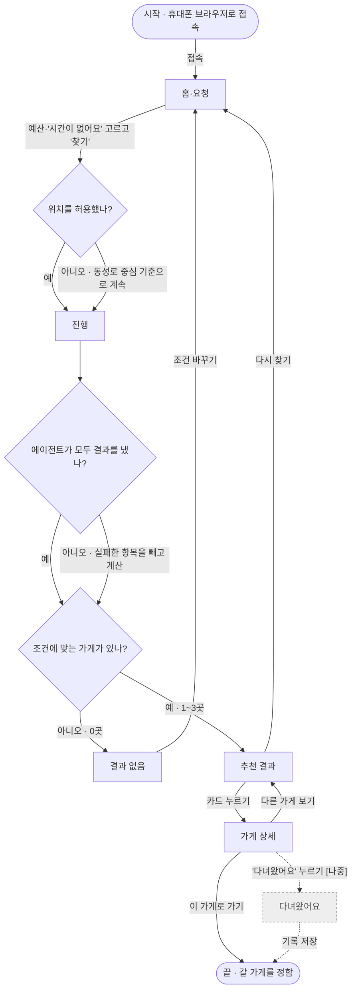

# 유저 플로우 — 계획 플로우 v0

- 작성일: 2026-11-26
- 종류: **계획 플로우**.
  웹페이지가 아직 없어 `spec/spec.md` 4절 스토리와 7.2 화면 목록으로만 그렸다.
  모든 화면과 경로는 "계획만 있음"이다.
- 웹페이지 주소(`{{WEB_URL}}`)가 생기면 `spec/spec.md` 7절 절차로 "실제 플로우"를 다시 그려 이 파일과 비교한다.
- 화면 이름은 `spec/spec.md` 7.2 목록만 썼다.

## 1. 순서도

- 둥근 상자는 시작·끝, 사각형은 화면, 마름모는 분기, 화살표 라벨은 사용자 행동이다.
- 점선과 회색 상자는 [나중] 스토리(US5)다.

## 2. 경로

### 2.1 주 경로

시작 → 홈·요청 → (위치 허용) → 진행 → (모든 에이전트 성공) → (가게 있음) → 추천 결과 → 가게 상세 → 끝

### 2.2 예외 경로

| 번호 | 갈림길 | 사용자가 보는 것 | 근거 (`spec/spec.md`) |
|---|---|---|---|
| X1 | 위치를 허용했나? → 아니오 | 추천 결과에 "동성로 중심에서 잰 거리예요" | US1 인수 조건 3 |
| X2 | 에이전트가 모두 결과를 냈나? → 아니오 | 추천 결과에 "날씨를 빼고 계산했어요"처럼 빠진 항목 한 줄 | US3 인수 조건 4, 6절 |
| X3 | 조건에 맞는 가게가 있나? → 아니오 | 결과 없음 화면, "조건 바꾸기"로 홈·요청에 돌아감 | US1 인수 조건 4 |
| X4 | (화면 안) 가게가 1~2곳뿐 | 추천 결과에 있는 만큼만, 이유 한 줄 | US1 인수 조건 4 |
| X5 | (화면 안) 1인 가격 없음 | 카드·상세의 가격 자리에 "가격 모름" | 6절, Q3 |
| X6 | (화면 안) 1인석 정보 없음 | 가게 상세에 "1인석 정보 없음" | US2 인수 조건 3 |

- X1~X3은 화면이 갈리는 분기라 순서도에 마름모로 넣었다.
- X4~X6은 같은 화면 안에서 문구만 바뀌어 순서도에 넣지 않았다.

## 3. 스토리 ↔ 화면

| 스토리 | 지나가는 화면 | 순서도 위치 |
|---|---|---|
| US1 [필수] 근처 3곳 받기 | 홈·요청 → 진행 → 추천 결과 (없으면 결과 없음) | 주 경로, X1·X3 |
| US2 [필수] 혼자 가도 되는지 근거 보기 | 추천 결과 → 가게 상세 | 주 경로 |
| US3 [필수] 추천 이유 보기 | 홈·요청("시간이 없어요") → 추천 결과 | 주 경로, X2 |
| US4 [나중] 1인석 있는 곳 먼저 | 추천 결과, 가게 상세 (화면 추가 없음) | 주 경로 (1인석 데이터가 생기면 표시) |
| US5 [나중] 다녀온 뒤 기록 | 가게 상세 → 다녀왔어요 | 점선 |

- 화면이 없는 필수 스토리: 없음.
- 스토리가 없는 화면: 없음.
  "진행" 화면은 US3에 묶었지만, 에이전트 단계를 보여 줄지는 아직 정하지 않았다(`spec/spec.md` Q2).

## 4. 완료 기준 점검 (`spec/spec.md` 7.5)

| 기준 | 결과 |
|---|---|
| Mermaid가 GitHub에서 그림으로 보인다 | 예 (2026-11-26 `k-1026/4P` main에서 확인. 긴 라벨은 끝 글자가 다음 줄로 넘어감) |
| 필수 스토리 US1~US3이 모두 주 경로 위 화면에 있고, 예외 분기가 2개 이상 있다 | 예 (분기 X1~X3, 3개) |
| 화면 이름이 7.2 목록만 쓴다 | 예 (목록 밖 화면: 없음) |
| 웹페이지와의 차이 | 아직 비교할 웹페이지가 없음 |

## 5. 질문 (팀이 정할 것)

- 위치를 거부했을 때 바로 동성로 중심으로 계속할지, 홈·요청에서 "동성로 어디쯤인지" 한 번 더 물을지?
- 에이전트가 실패했을 때 사용자에게 다시 시도 버튼을 줄지, 빼고 계산한 결과만 보여 줄지?
- "이 가게로 가기"를 누르면 지도 앱으로 넘길지(지도 링크 사용 범위), 화면 안에서 끝낼지?
