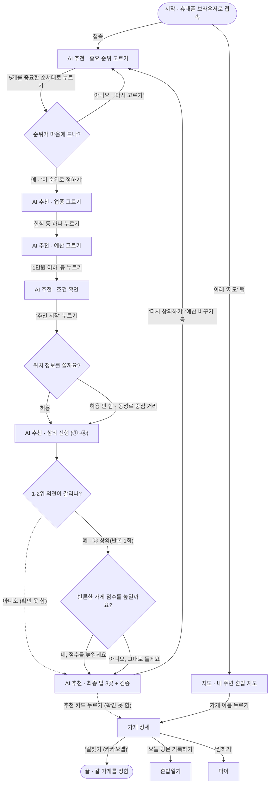

# 유저 플로우 — 실제 플로우 v1

- 작성일: 2026-11-26
- 종류: **실제 플로우**.
  웹페이지 <https://honbap-bapchingu.vercel.app> 를 `spec/spec.md` 7절 절차로 직접 지나가며 그렸다.
- 확인 환경: Claude 내장 브라우저, 폭 375px(휴대폰 크기), 2026-11-26.
- 시험 조건: 중요 순위 거리 > 자리 > 가격 > 날씨 > 새로움, 업종 한식, 예산 1만 원 이하, 위치 허용 안 함.
- v0 계획 플로우는 맨 아래 부록에 남겨 두고, 둘의 차이는 4절에 적었다.
- 화면 이름은 앱에 보이는 이름을 쓰고, `spec/spec.md` 7.2 목록의 어느 화면에 해당하는지 3절에 대응시켰다.

## 1. 순서도

- 둥근 상자는 시작·끝, 사각형은 화면(또는 채팅 안 단계), 마름모는 분기, 화살표 라벨은 사용자 행동이다.
- 점선은 이번에 직접 지나가지 않은 경로("확인 못 함")다.

## 2. 경로

### 2.1 주 경로 (이번에 지나간 길)

시작 → AI 추천(중요 순위 → 업종 → 예산 → 조건 확인) → 위치 허용 안 함 → 상의 진행 ①~⑤ → 점수 높이기 선택 → 최종 답 3곳 + 검증 8/8

- 상의 진행은 한 채팅 화면 안에서 단계 제목으로 나뉜다.
  ① 밥톨이들의 첫 의견, ② 후보 고르기(1km 안 가까운 20곳), ③ 탈락 확인(20곳 카드), ④ 1차 점수, ⑤ 상의(반론 1회).
- 지도 → 가게 상세는 따로 지나가며 확인했다.

### 2.2 예외·갈림 경로

| 번호 | 갈림길 | 사용자가 본 것 | 확인 |
|---|---|---|---|
| X1 | 위치 정보를 쓸까요? → 허용 안 함 | "내 위치 없이 추천할게요.", "동성로 중심에서 잰 거리예요" | 확인함 |
| X2 | 순위가 마음에 드나? → 아니오 | "다시 고르기" 버튼 | 버튼만 확인 |
| X3 | 반론한 가게 점수를 높일까요? | "네, 점수를 높일게요" / "아니요, 그대로 둘게요" 두 버튼 | "네" 쪽만 지나감 |
| X4 | 조건에 맞는 가게가 없을 때 | — | 확인 못 함 |
| X5 | 에이전트 하나가 실패할 때 | — | 확인 못 함 (이번에는 "부족한 것 없이 모두 준비됐어요") |
| X6 | (화면 안) 1인석 정보 없음 | 카드 "좌석 모름", 상세 "1인석·좌석 정보는 아직 모으는 중이에요" | 확인함 |
| X7 | (화면 안) 가격 정보 없음 | 지도 목록 "가격 정보 없음" | 확인함 |

- X3은 "아니요"를 누르려다 "네"가 눌렸다.
  그래서 1순위가 반론한 가게(윤소인남산고담백장어죽 8.8점)로 바뀐 결과를 봤다.

## 3. 화면 목록과 `spec.md` 7.2 대응

| 앱 화면 (실제 이름) | 하는 일 | `spec.md` 7.2 화면 | 스토리 |
|---|---|---|---|
| AI 추천 · 중요 순위 고르기 | 날씨·자리·새로움·가격·거리 순위 → 가중치 33·27·20·13·7% | 홈·요청 | US1·US3 |
| AI 추천 · 업종 / 예산 고르기 | 한식·양식·중식·일식·분식·기타·상관없음 / 8천~2만 원·상관없음 | 홈·요청 | US1 |
| 위치 정보 시트 | 허용 / 허용 안 함 | **목록 밖** | US1 |
| AI 추천 · 상의 진행 ①~⑤ | 에이전트 발언, 후보 20곳 카드, 1차 점수표, 반론 | 진행 | US3 |
| AI 추천 · 최종 답 | 3곳, 총점, 이유, "AI 추천" 라벨, 확실도, 검증 8가지 | 추천 결과 | US1·US3 |
| 지도 · 내 주변 혼밥 지도 | 지도 + 가까운 순 목록(혼밥 좋아요 수·대표 메뉴·가격·거리) | **목록 밖** | US1·US2 |
| 가게 상세 | 1인분 가능, 혼밥 후기 수, 거리, 1인 메뉴, "AI가 … 적은 값 (사람 확인 전)", 1인석, 방문 기록·찜·길찾기 | 가게 상세 | US2·US4 |
| 혼밥일기 | 일기 목록(모두·이웃 공유), 쓰기 | 다녀왔어요 [나중] | US5 |
| 마이 | 혼밥 레벨, 찜한 가게 | **목록 밖** | 없음 |
| (결과 없음) | — | 결과 없음 | US1 (확인 못 함) |

- 목록 밖 화면: 위치 정보 시트, 지도, 마이.
  `spec.md` 7.2에 넣을지는 팀이 정한다(5절).
- 화면이 없는 필수 스토리: 없음.

## 4. 계획(v0)과 다른 점

`spec/spec.md` 7.3의 5번에 따라 spec은 고치지 않고 차이만 적는다.

| 번호 | 계획 (`spec.md`) | 실제 앱 | 영향 |
|---|---|---|---|
| C1 | 한 문장 요청 + 예산·"시간이 없어요" 선택 | 중요 순위 5개 → 업종 → 예산 버튼. "시간이 없어요" 버튼은 없음 (아래 "순위 바꾸기"·자유 입력은 있음) | US3 인수 조건 3을 확인할 수 없음 |
| C2 | 가중치는 `criteria.json` 고정 열 + 혼밥 MBTI 배수 | 사용자가 고른 순위로 33·27·20·13·7% | `00_전체구조.md` 5장과 다름 |
| C3 | 상의는 점수를 바꾸지 않는다 (`criteria.json` `debate.can_change_score: false`) | 사용자가 "점수를 높일게요"를 고르면 반론한 가게 점수가 오름 (6.13 → 8.8) | 규칙 충돌. 팀 결정 필요 |
| C4 | 총점 `x.x / 10` (소수 첫째 자리) | `7.80점`, `6.13점` (소수 둘째 자리) | 6절 완료 기준·검증 R1과 다름 |
| C5 | 검증은 화면에 드러나지 않음 | 최종 답 아래 "검증 승인 · 규칙 8가지 중 8가지 통과" | 계획보다 많이 보여 줌 (문제 아님) |
| C6 | 가게 상세는 추천 결과에서 들어감 | 지도 목록에서 들어감을 확인. 추천 카드에서 들어가는지는 확인 못 함 | 다시 확인 필요 |
| C7 | 다녀왔어요 [나중]: 1인분 됨/안 됨, 1인석, 별점 | 혼밥일기(사진 1장 이상 필수), 레벨, 공유 | 1인분·1인석을 묻는 칸이 있는지 확인 못 함 |
| C8 | (같음) 위치 거부 문구, "AI 추천" 라벨, "사람 확인 전" 라벨, 1인석 모름 표시 | 모두 있음 | US1·US2·US3 인수 조건 일부 충족 |

## 5. 질문 (팀이 정할 것)

- C3: 사용자가 상의 결과로 점수를 바꾸게 할지, `criteria.json`처럼 확실도만 바꾸게 할지?
- C1·C2: "시간이 없어요"와 혼밥 MBTI 가중치를 앱의 중요 순위 방식으로 바꿀지, 둘 다 둘지?
- 위치 정보 시트·지도·마이를 `spec.md` 7.2 화면 목록에 더할지?
- C4: 총점을 소수 첫째 자리로 맞출지?

## 6. 완료 기준 점검 (`spec/spec.md` 7.5)

| 기준 | 결과 |
|---|---|
| Mermaid가 GitHub에서 그림으로 보인다 | 확인 필요 — v1로 바꾼 뒤 다시 본다 (v0는 2026-11-26 확인) |
| 필수 스토리 US1~US3이 모두 주 경로 위 화면에 있고, 예외 분기가 2개 이상 있다 | 예 (분기 X1~X3) |
| `spec/ia.md` 사이트맵 깊이 3 이내, 라벨이 사용자의 말 | 예 (`spec/ia.md`) |
| "목록 밖 화면"과 "차이" 목록이 있다 | 예 (3절, 4절) |

## 부록. 계획 플로우 v0 (비교용)

