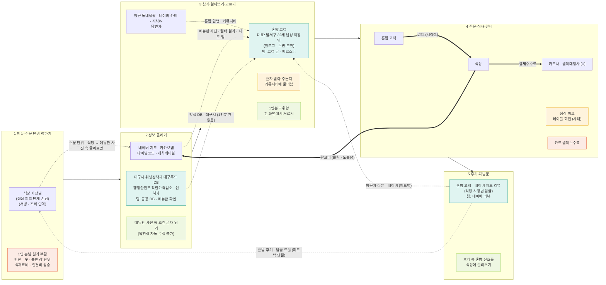

# 밸류체인 맵 v2 — 대구 외식 · 혼밥 산업 체인

- 작성일: 2026-11-24
- v1에서 바꾼 것: `밸류체인_v2_수정검토판_20261124_표시본.md` 1~22번 팀 결정 (2026-11-24 검증).
  v1(`valuechain_v1.md`, `valuechain_v1.html`)은 고치지 않고 보관한다.
- 논의 기준은 발표용 `valuechain_v2.html`이다.
  이 md는 html 결정에 맞춰 고쳤다.
- 단계: 1 메뉴·주문 단위 정하기 → 2 정보 올리기 → 3 찾기·알아보기·고르기 → 4 주문·식사·결제 → 5 후기·재방문
- 화살표: 상품·정보 흐름 `-->`, 돈 흐름 `==>` (고객 → 원천 방향), 데이터 흐름 `-.->` (라벨: 데이터 이름 · 가진 쪽)
- 색: 병목 주황, 비용 코랄, 기회 라임, 팀이 가진 자료 틸
- 하는 사람과 영향 주는 사람: 영향 주는 사람은 (괄호)로 적는다.
- 배달 · 포장은 고객여정지도 범위 밖이라 맵에서 뺐다 (v2 1번, V7 변경).
  우리 고객은 가서 먹는 사람이다 [출처 30].
- 숫자는 [출처]가 있는 것만 넣었다.
  라벨 안 숫자는 카드 결제수수료 0.4~1.45% 하나뿐이다 [출처 39].

- 마지막 화살표(5 → 1 피드백 단절)는 회색 점선이다 (v2 10번).
  비용 마커의 코랄색과 헷갈리지 않게 했다.

## 단계별 근거

| 단계 | 이해관계자 | 돈 | 데이터 (이름 · 가진 쪽 · 피드백) | 마커 | 근거 |
|---|---|---|---|---|---|
| 1 메뉴·주문 단위 정하기 | 식당 사장님, (점심 피크 단체 손님), (서빙 · 조리 인력) | 고객 결제가 식당 매출로 도착 (끝점) | 주문 단위 · 식당 → 메뉴판 사진 속 글씨로만 [출처 35]. 공공 DB 905곳 중 표기: 2인 이상 16 · 1인분 28 [출처 11]. 후기 피드백이 거의 돌아오지 않음 | 비용: 1인 손님 원가 부담 | [출처 11], [출처 12], [출처 33], [출처 34], [출처 35], [출처 36] |
| 2 정보 올리기 | 지도 앱 4곳, 대구시 위생정책과, 행정안전부, 식당 사장님. 팀: 공공 DB · 메뉴판 확인 [출처 10][출처 14][출처 15][출처 34][출처 35] | 식당 → 지도 앱: 광고비 (클릭 · 노출당). 네이버 플레이스광고는 클릭당 50~5,000원(VAT 별도), 카카오 '우리매장 알리기'는 1,000회 노출당 500원 [출처 40] | 메뉴판 사진 · 지도 앱, 맛집 DB · 대구시 (1인분 칸 없음) | 기회: 메뉴판 사진 속 조건 글자 읽기 (약관상 자동 수집 불가 [출처 41]) | [출처 10], [출처 11], [출처 16], [출처 35], [출처 40], [출처 41] |
| 3 찾기·알아보기·고르기 | 혼밥 고객(대표 페르소나), 지도 앱, 당근 동네생활 · 네이버 카페 · 지식iN 답변자. 팀: 고객 글 · 페르소나 [출처 23][출처 24][출처 27] | 없음 (찾기는 무료) | 필터 결과 · 지도 앱, 혼밥 답변 · 커뮤니티, 리뷰 · 네이버 (피드백) | 병목: 커뮤니티에 물어봄. 기회: 1인분 + 취향 한 화면 거르기 | [출처 6], [출처 16], [출처 27], [출처 30], [출처 31] |
| 4 주문·식사·결제 | 혼밥 고객, 식당, 카드사 · 결제대행사 [U] | 손님 → 식당: 결제 (시작점). 식당 → 카드사: 결제수수료, 우대수수료율 신용 0.40~1.45% (연매출 30억 이하 구간) [출처 39] | 결제 내역 · 식당 · 카드사 [I] | 병목: 점심 피크 테이블 회전 (사례). 비용: 카드 결제수수료 | [출처 36], [출처 39] |
| 5 후기·재방문 | 혼밥 고객, 네이버 지도, (식당 사장님 답글). 팀: 네이버 리뷰 [출처 25] | 없음 | 방문자 리뷰 · 네이버 → 3단계 고객에게 (피드백), → 1단계 식당에는 거의 안 돌아감 | 기회: 후기 속 혼밥 신호를 식당에 돌려주기 | [출처 25], [출처 30], [출처 35] |

- 돈의 시작점: 4단계 고객 결제.
  끝점: 식당(매출, 1단계), 카드사(결제수수료), 지도 앱(광고비).
- 우리 서비스가 정한 수익(광고 배너 · 검색창 상단 고정 노출, R1 2026-11-23 결정)은 2단계 "식당 → 지도 앱: 광고비"와 같은 자리를 두고 경쟁한다 [I].
  서비스 체인과 A8에서 다룬다.

## 마커 요약

| 종류 | 마커 | 단계 | 신호 |
|---|---|---|---|
| 병목 | 혼자 받아 주는지 커뮤니티에 물어봄 | 3 | G4 한 사람 의존 |
| 병목 | 점심 피크 테이블 회전 (사례) | 4 | G8 대기·지연 |
| 비용 | 1인 손님 원가 부담 | 1 | C1 + C2 (여섯 신호 밖, V12) |
| 비용 | 카드 결제수수료 0.4~1.45% | 4 | G9 중간 차감 중첩 |
| 기회 | 메뉴판 사진 속 조건 글자 읽기 (약관상 자동 수집 불가) | 2 | G1 정보 재입력 |
| 기회 | 1인분 + 취향 한 화면 거르기 | 3 | G3 데이터 단절 |
| 기회 | 후기 속 혼밥 신호를 식당에 돌려주기 | 5 | G10 데이터 단절 |

## 근거 없이 남은 항목

- 카드사 · 결제대행사 실명 [U] (수수료율은 [출처 39]로 확인)
- 카카오 '우리매장 맵광고' 업종별 일 단가 [U] (로그인 화면에만 나옴)
- 4단계 결제 내역 데이터 보유자 [I]
